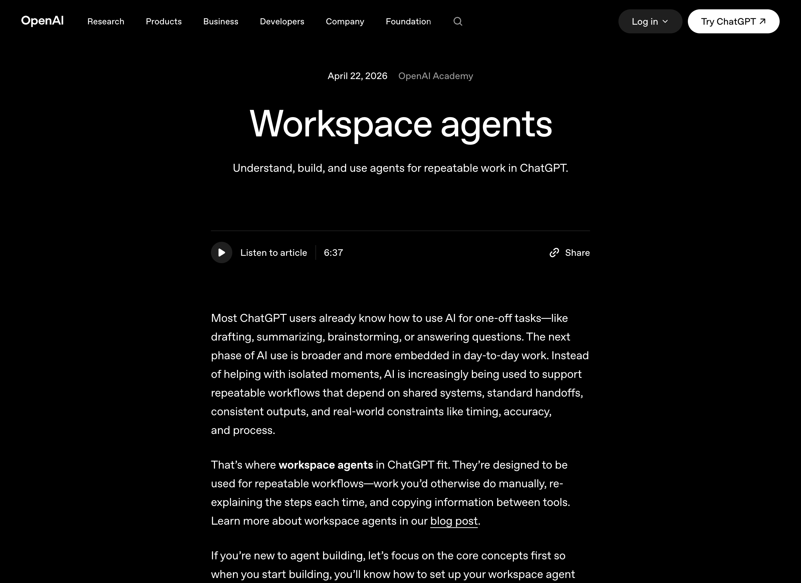

# OpenAI Workspace Agents 完整分析

> **原文**：[Workspace agents | OpenAI](https://openai.com/academy/workspace-agents/)
> **发布日期**：April 22, 2026
> **来源**：OpenAI Academy
> **翻译+分析**：2026-04-24

---

## 📸 原文截图



---

## 一、引言

大多数 ChatGPT 用户已经知道如何用 AI 完成一次性任务——比如起草、总结、头脑风暴或回答问题。但 AI 使用的下一阶段更加广泛，也更深入地嵌入到日常工作中。**AI 不再只是帮助完成孤立的时刻，而是越来越多地被用来支持可重复的工作流**——这些工作流依赖于共享系统、标准交接、一致的输出，以及现实世界的约束，如时间、准确性和流程。

这就是 ChatGPT 中 **Workspace Agents（工作区代理）** 的用武之地。它们被设计用于**可重复的工作流**——那些你本需要手动完成、每次都要重新解释步骤、在不同工具之间复制信息的工作。

> 💡 **了解更多**：可参阅 OpenAI 的官方博客文章了解 Workspace Agents 的背景。

如果你是代理构建的新手，让我们先关注核心概念，这样当你开始构建时，就知道如何设置你的工作区代理以获得一致的结果。

---

## 二、什么是 Agent？

一般来说，**Agent 是一个执行任务的系统**，包含三个组件：**触发器（Trigger）**、**可能包含专业技能的流程（Process）**，以及**它可以连接的工具或系统（Tools）**。

| 组件 | 描述 | 示例 |
|---|---|---|
| **触发器（Trigger）** | 启动 Agent 的事件 | 定时调度（"每个工作日 9 点"）或手动触发（"立即运行"） |
| **流程和技能（Process & Skills）** | Agent 按照预期完成任务所遵循的步骤 | 审查输入、检查缺失信息、起草输出、交接或执行下一步操作 |
| **工具和系统（Tools & Systems）** | Agent 可以用来收集信息并（在允许的情况下）执行操作的已批准工具和集成 | Slack、CRM、内部文档、工单系统或共享文档 |

### Agent 最适合的场景

Agent 在以下类型的工作中最为有用：

- **可重复（Repeatable）**：相同的任务定期出现
- **结构化（Structured）**：输出有清晰的格式（这样你就能判断 Agent 是否做得好）
- **基于时间或事件驱动（Time-based or Event-driven）**：它按节奏运行或由事件触发
- **基于工具（Tool-based）**：它需要读取或写入你的团队使用的系统

对于开放式思考、头脑风暴或探索性写作，**普通聊天通常更适合**——尤其是一次性任务。

### Agent vs 传统 API 工作流

Agent 也与你过去构建的传统 API 工作流不同。传统工作流通常是**确定性的**——每个步骤都明确定义，系统每次都遵循相同的路径，除非你更改逻辑。**Agent 更加概率化**。它们仍然在指令、工具和护栏内运行，但它们使用模型来解释上下文、做出有界决策，并调整它们如何推进工作。

---

## 三、Agent 的解剖结构

设计工作区 Agent 的一个有效方法是将其分解为几个部分。想象一下你在把工作交给一个人之前需要明确什么：

- **责任范围**（Objective）：它的职责是什么？
- **启动时机**（Trigger）：它何时开始？
- **暂停或停止的条件**（Governance）：什么情况下应该停下来升级？
- **可用资源**（Tools）：它可以使用的工具和信息来源？
- **执行流程**（Process）：它应该遵循的步骤？
- **约束规则**（Guardrails）：它必须遵守的规则？

> 📌 Agent 可能需要访问应用。了解更多关于 ChatGPT 中的应用。

### Agent 分解示例

#### 示例 1：营销活动总结 Agent

| 维度 | 内容 |
|---|---|
| **目标** | 分析活动表现并提出优化建议 |
| **触发器** | 每周一上午 10 点 |
| **流程** | 拉取 KPI、识别趋势、起草总结、提出下一步行动、分配负责人 |
| **工具** | 分析工具和共享总结文档 |
| **治理** | 起草建议；预算变更需审批 |

#### 示例 2：产品反馈分类 Agent

| 维度 | 内容 |
|---|---|
| **目标** | 汇总新产品反馈并路由给合适的负责人 |
| **触发器** | 来自 Slack 的表单提交 |
| **流程** | 审查反馈、分组相关项、总结关键主题、建议跟进负责人 |
| **工具** | Slack、工单系统和总结文档 |
| **治理** | 创建草稿工单；升级高优先级问题；提交前需审批 |

#### 示例 3：销售漏斗摘要 Agent

| 维度 | 内容 |
|---|---|
| **目标** | 监控漏斗变化并突出风险和机会 |
| **触发器** | 每个工作日 8 点 |
| **流程** | 审查漏斗、标记风险、提出下一步行动 |
| **工具** | CRM、邮件或 Slack、漏斗跟踪器 |
| **治理** | 起草洞察和建议；通知负责人；未经批准不得直接联系 |

---

## 四、Agent 工作流模式

以下示例可以视为 **Agent 工作流模式**——跨团队和职能中常见的、可重复的工作模式。每种模式代表 Agent 可以执行的核心工作类型。

### 1. Briefing（简报模式）

从多个地方拉取信息，提炼并打包成可供决策的格式。

**步骤**：
1. 收集输入
2. 比较并提取关键信号
3. 为受众总结
4. 分享为文档、备忘录或简报

**用例**：
- 销售：从 CRM、通话、Slack 和新闻构建客户简报
- 营销：从分析、社交媒体和文档编译活动或竞争回顾
- 高管：生成每日行业简报并提出建议

### 2. Triage and Routing（分类与路由模式）

处理传入项目并确保它们到达正确的下一步。

**步骤**：
1. 审查传入项目
2. 分类和优先级排序
3. 路由或创建下一步工件
4. 通知负责人和请求者

**用例**：
- 客服：将反馈转化为 Bug、功能请求或后续跟进
- IT/运维：处理 Slack 中的内部请求并按紧急程度路由
- 招聘：筛选 incoming 候选人并将其移入正确的流程

### 3. Analysis and Recommendation（分析与建议模式）

解释数据或证据，形成观点，并将其转化为第一个交付物。

**步骤**：
1. 拉取源数据
2. 分析模式、差距和权衡
3. 形成建议
4. 起草备忘录、PPT、电子表格或邮件

**用例**：
- 财务：对账预算与实际支出并起草经理备忘录
- 产品/研究：分析用户反馈并提出优先级
- 采购：比较供应商报价、创建决策矩阵、起草采购订单邮件

### 4. Content Creation（内容创作模式）

创建或更新内容，然后针对特定受众或渠道进行调整。

**步骤**：
1. 从笔记或源材料生成初稿
2. 编辑语气和准确性
3. 针对受众和渠道定制
4. 发布或发送

**用例**：
- 营销：将简报转化为活动素材并传阅征求意见
- 经理：将笔记转化为入职计划或培训模块
- 销售：撰写跟进邮件、季度业务回顾摘要或利益相关者回顾

### 5. Planning and Coordination（规划与协调模式）

将目标转化为计划好的工作和系统更新。

**步骤**：
1. 从约束条件构建计划
2. 检查依赖关系和可用性
3. 执行操作或准备操作
4. 更新系统并通知人员

**用例**：
- PM/幕僚长：分配工作、安排会议并更新跟踪器
- 活动：协调离线会议、注册或旅行计划
- 行政：管理表单、提醒、订单、预订和后续跟进

---

## 五、在 ChatGPT 中使用 Agent

你可能一开始会使用你的组织已经构建好的 Agent。首先了解 Agent 被设计用来做什么——它支持哪些任务、依赖哪些工具、产生什么样的输出。

- **从低风险的请求开始**，观察它的行为
- 尝试简单的输入，然后审查结果以了解它如何处理任务
- **即使构建得很好的 Agent 仍然受益于人类判断**——你通常才是那个了解更广泛背景、任务重要性和什么是好答案的人

---

## 六、在 ChatGPT 中构建自己的 Agent

一旦你理解了基础知识并确定了强有力的用例，就可以开始构建自己的 Workspace Agent 了。你可能已经在 ChatGPT 中构建了 Skills。Workspace Agents 可以在其指令中使用 Skills。

> ⚠️ 注意：在 ChatGPT Enterprise 中，构建 Agent 的访问权限由你的工作区管理员控制。

### 构建步骤

1. **用自然语言开始**：在 Agent 构建器聊天中，描述 Agent 应该做的工作、成功的结果是什么样的，以及它需要遵循的任何约束。构建器可以将其转化为有明确步骤的清晰工作流，你可以在聊天中持续优化，也可以直接在工作和指令中编辑。

2. **选择工具和连接器**：选择 Agent 可以完成工作流的已批准应用。你也可以描述 Agent 需要访问的系统，构建器会指导你添加和认证它们。

3. **选择触发器**：决定 Agent 何时运行。Agent 触发器是启动 Agent 运行的事件。对于工作区 Agent，它可以是**人工触发**（某人要求它做某事）、**调度触发**（它在固定时间运行）。你可以使用 Agent 构建器聊天用自然语言设置触发器。

4. **添加护栏**：为敏感操作设置边界、所需审批和任何人在环（human-in-the-loop）检查点。你可以直接在 Agent 构建器聊天中添加这些，构建器将修改指令。

### 使用预览测试你的 Agent

Agent 构建最好作为一个**迭代过程**。在 ChatGPT 中，构建器是这个循环的一部分。当你测试 Agent 时，使用对话来了解发生了什么、发现问题并逐步完善指令。

从几个现实示例开始，包括简单的请求和更混乱的（缺少上下文或模棱两可的）请求。这有助于你了解 Agent 的行为以及它可能需要更清晰指令或护栏的地方。

### 编辑你的 Agent

当你测试 Agent 时，第一个版本不完美是意料之中的。当感觉有问题时，有两种有效的方法来改进它：

- **直接更新指令**：在编辑器中进行小的、具体的更改，如澄清步骤、调整输出格式或添加约束
- **用自然语言指导**：当问题不太明确时，使用构建器对话来解决问题。你可以指出它遗漏了什么、提出开放性问题，或让它解释其推理以暴露指令中的差距

做出更改后，再次测试以确认更新有效。

### 将 Agent 扩展到你的团队

Workspace Agents 是为共享的、可重复的工作而设计的。共享一个 Agent 给你的团队提供了一种一致的方式来完成任务，而不是每次都重新发明流程。

共享 Agent 时，要明确它的用途。在描述中包括它处理的任务、何时使用它、提供什么输入以及期望什么样的输出。**共享 Agent 在与你团队已经理解的特定重复工作流绑定时效果最佳**。包含一两个示例提示也可以给其他人一个清晰的起点，使采用更加顺畅。

> 📌 请记住，工作区管理员通过基于角色的访问控制（RBAC）管理连接器和功能访问，因此队友可能需要适当的权限才能使 Agent 与 Slack、Gmail 或其他工具一起工作。

---

## 七、深度分析与个人理解

### 🔬 Agent 与传统工作流的本质区别

这篇文章最核心的洞察在于区分了**确定性工作流**与**概率性 Agent**：

```
传统工作流：if-then-else → 确定性的路径
Agent 工作流：目标+约束 → 模型自主决策路径
```

传统自动化工具（如 Zapier、n8n）需要你定义每一步。Agent 只需要定义目标、约束和工具，让 LLM 自主决定如何完成任务。这意味着：
- **更灵活**：面对意外情况可以自主调整
- **更脆弱**：结果不是完全可预测的，需要护栏和审批机制

### 🏗️ 五种工作流模式的抽象价值

OpenAI 提出的五种模式（Briefing、Triage、Analysis、Content、Planning）实际上覆盖了企业知识工作的主要场景：

| 模式 | 核心能力 | 典型场景 |
|---|---|---|
| Briefing | 信息聚合 + 提炼 | 日报、周报、竞争分析 |
| Triage | 分类 + 路由 | 工单分配、反馈处理 |
| Analysis | 数据分析 + 建议 | 财务对账、用户研究 |
| Content | 创作 + 适配 | 营销素材、内部文档 |
| Planning | 规划 + 协调 | 排期、活动组织 |

这五种模式可以作为企业 Agent 设计的**设计模式参考**，类似于软件工程中 GoF 的 23 种设计模式。

### 🧩 与 SkillForge 平台的对比思考

将这篇文章中的概念与 SkillForge 平台对比：

| 维度 | ChatGPT Workspace Agents | SkillForge |
|---|---|---|
| 触发器 | 定时 + 手动 | Hook 驱动（session/lifecycle） |
| 工具集成 | Slack/CRM/Gmail 等 SaaS | 自定义 Hook + 脚本方法 |
| 流程定义 | 自然语言指令 | SKILL.md + Java 方法 |
| 治理 | 审批 + 人在环 | Hook 拦截 + 权限控制 |
| 共享方式 | 团队内共享 Agent | Skill 注册 + 平台分发 |

**关键差异**：
- ChatGPT Agent 更侧重**非技术用户**的易用性（纯自然语言）
- SkillForge 更侧重**开发者**的灵活性和可编程性（Java + Hook）
- 两者都在解决同一个问题：**如何把 AI 从"问答工具"变成"可重复执行任务的工作者"**

### 🎯 实践建议

1. **从简单开始**：不要一开始就构建复杂的 Agent，从 Briefing 模式开始最容易
2. **明确输出格式**：结构化输出是判断 Agent 是否合格的关键
3. **设置护栏**：尤其是涉及写操作时，审批机制不可少
4. **迭代优化**：第一个版本不完美是正常的，通过测试→反馈→调整循环改进
5. **善用工具而非替代**：Agent 是增强而非替代人类判断

---

## 八、延伸阅读

| 主题 | 日期 |
|---|---|
| [Using custom GPTs](https://openai.com/academy/using-custom-gpts/) | Apr 10, 2026 |
| [Using projects in ChatGPT](https://openai.com/academy/using-projects/) | Apr 10, 2026 |
| [Using skills](https://openai.com/academy/using-skills/) | Apr 10, 2026 |

---

*本文档由 SkillForge Agent 通过obsidian-cli 自动创建*
