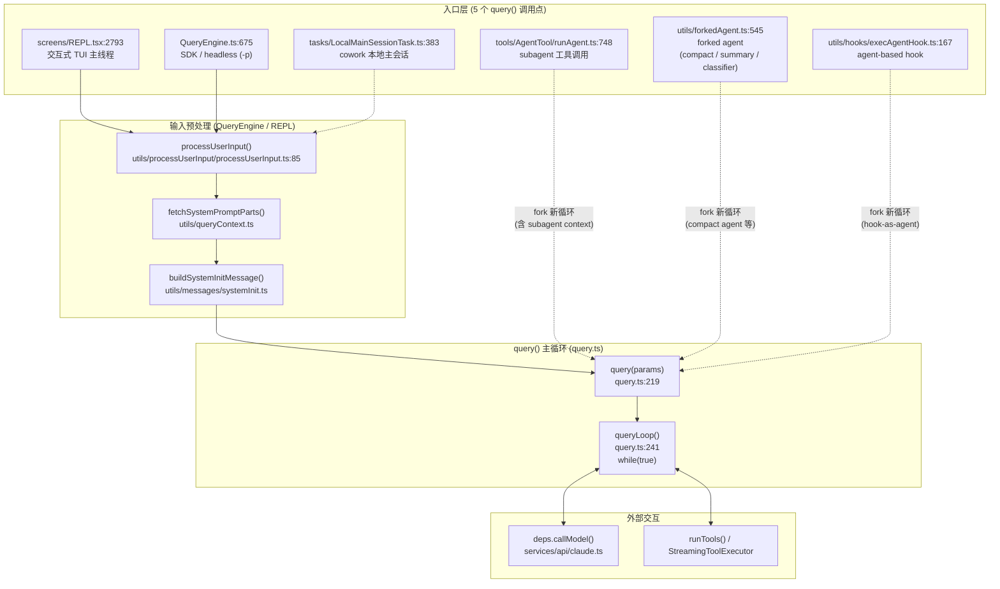
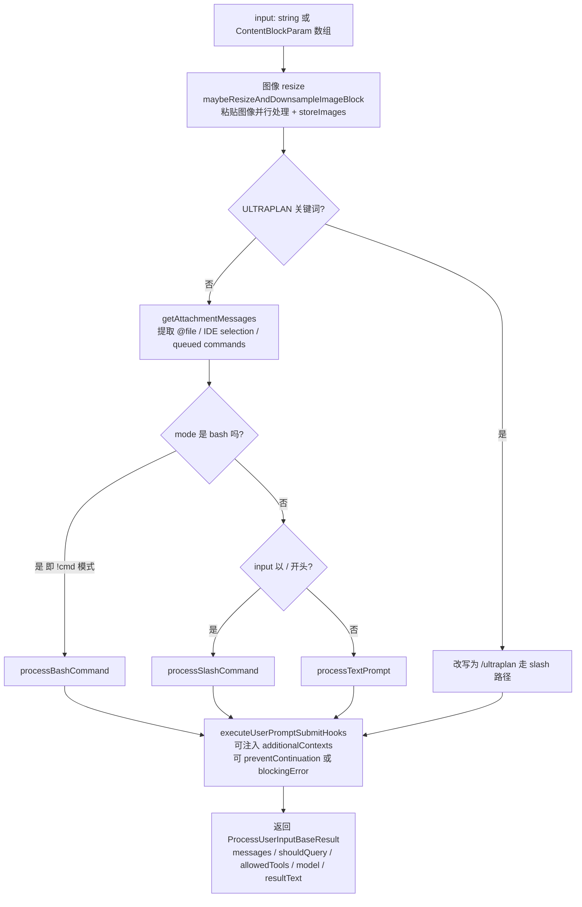
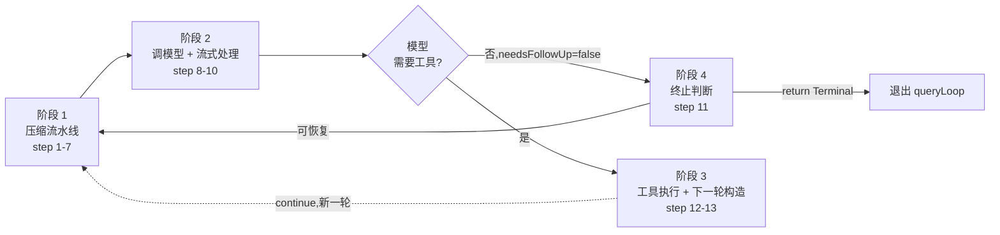
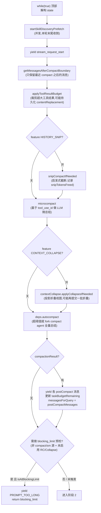
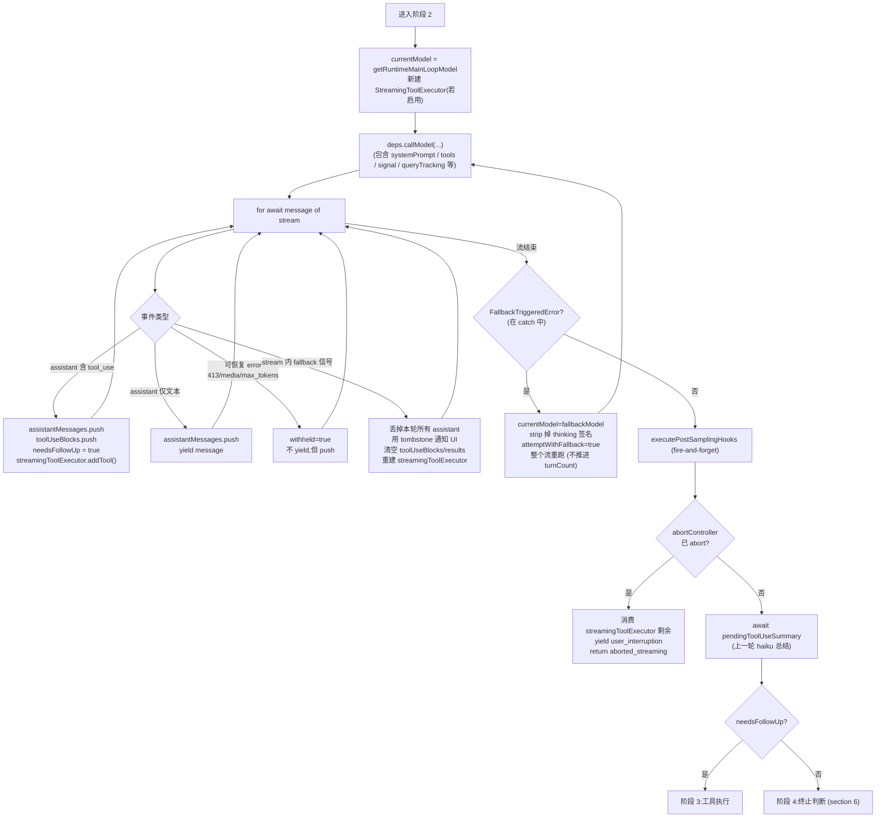
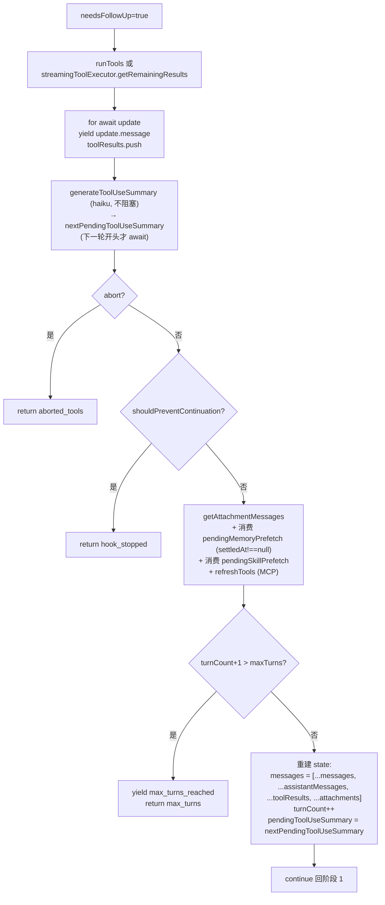
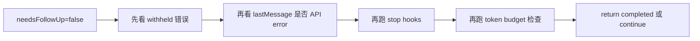
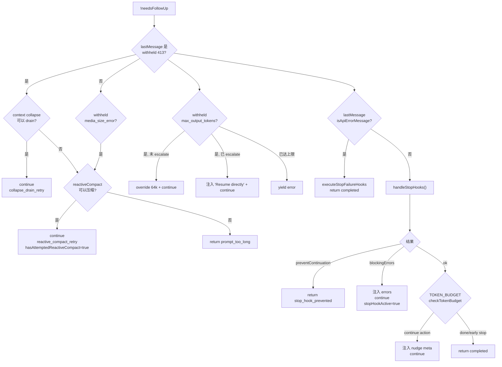

# Agent 主循环 (query.ts / QueryEngine.ts)

**源码**:
- `src/query.ts` (1729 行) — 主循环本体 `query()` / `queryLoop()`
- `src/QueryEngine.ts` (1295 行) — SDK/headless 会话层
- `src/Task.ts` (125 行) — 后台任务注册表(不是主循环)
- `src/utils/processUserInput/processUserInput.ts` (605 行) — 用户输入预处理
- `src/screens/REPL.tsx` — 交互式 REPL 调用方
- `src/query/config.ts` / `src/query/deps.ts` / `src/query/tokenBudget.ts` / `src/query/stopHooks.ts` — 主循环拆出的配置与依赖

---

## 1. 鸟瞰:从用户按下回车到模型响应



**5 个 `query()` 调用点一览**(`grep "query(" src/`):

| 调用点 | 作用 | querySource |
|---|---|---|
| `REPL.tsx:2793` | 交互式 TUI 每次用户按回车 | `repl_main_thread` |
| `QueryEngine.ts:675` | SDK / `claude -p` 非交互 | `sdk` |
| `LocalMainSessionTask.ts:383` | cowork 模式的本地主会话 task | `local_main_session` |
| `tools/AgentTool/runAgent.ts:748` | 主 agent 调用 `Task` 工具时 spawn 子 agent | `agent:*` |
| `utils/forkedAgent.ts:545` | 系统内部 fork agent (compact / session_memory / transcript_classifier) | `compact` / `session_memory` / ... |
| `utils/hooks/execAgentHook.ts:167` | Agent-based hook(用 agent 作为钩子执行) | `agent_hook` |

**关键洞察**:`query()` 不只是 SDK 用,REPL 直接在 `useEffect` 里 `for await`,所以 **主交互循环和 SDK 共用一套 agent loop**,只是 UI 层怎么消费 yield 出的消息不一样(REPL 走 `handleMessageFromStream` → `setMessages`,SDK 走 `normalizeMessage` → stdout)。

---

## 2. 用户输入路径详细追踪

### 2.1 REPL 路径 (`screens/REPL.tsx`)

用户在 TextInput 按回车后(简化版路径):

```
PromptInput.onSubmit
  → handlePromptSubmit()           utils/handlePromptSubmit.ts
  → processUserInput(...)          utils/processUserInput/processUserInput.ts:85
  → onQueryImpl(messages, ...)     REPL.tsx:2661
      ├─ diagnosticTracker.handleQueryStart()
      ├─ getSystemPrompt() + getUserContext() + getSystemContext()  ← 并行
      ├─ buildEffectiveSystemPrompt()
      └─ for await (const event of query({...}))    ← REPL.tsx:2793
          └─ onQueryEvent(event)
              └─ handleMessageFromStream(event, setMessages, ...)   utils/messages.ts
                  ├─ isCompactBoundaryMessage → setMessages([newMessage])  (清空 UI)
                  ├─ type === 'progress' + ephemeral → 替换最后一条(防止 13k 条堆积)
                  └─ 默认 → setMessages(prev => [...prev, newMessage])
```

### 2.2 SDK / headless 路径 (`QueryEngine.ts`)

```
QueryEngine.submitMessage(prompt)           QueryEngine.ts:209
  ├─ 清理 turn-scoped 状态 (discoveredSkillNames.clear())
  ├─ setCwd(cwd)                            utils/Shell.ts
  ├─ wrappedCanUseTool = wrap(canUseTool)   (追踪 permission_denials)
  ├─ fetchSystemPromptParts()               utils/queryContext.ts
  │    → 返回 { defaultSystemPrompt, userContext, systemContext }
  │    → 含 tools/mcpClients/cwd/model/additionalWorkingDirectories
  ├─ asSystemPrompt([custom, memoryMechanics, defaultSystemPrompt, append])
  ├─ hasAutoMemPathOverride() → loadMemoryPrompt()   memdir/memdir.ts
  ├─ processUserInput({ input, mode: 'prompt', context, ... })
  │    → { messages, shouldQuery, allowedTools, model, resultText }
  ├─ mutableMessages.push(...messagesFromUserInput)
  ├─ recordTranscript(messages)             utils/sessionStorage.ts  (持久化 .jsonl)
  ├─ setAppState(prev => ({ ...prev, alwaysAllowRules.command: allowedTools }))
  ├─ getSlashCommandToolSkills(cwd) + loadAllPluginsCacheOnly()   ← 并行
  ├─ yield buildSystemInitMessage({ tools, mcpClients, model, permissionMode, commands, agents, skills, plugins })
  │
  ├─ if (!shouldQuery):     // slash 命令本地执行完,无需调 API
  │    └─ yield 本地命令的 stdout/stderr 作为 SDKUserMessageReplay
  │    └─ yield 'result' { subtype: 'success' }
  │    └─ return
  │
  └─ for await (const message of query({ messages, systemPrompt, userContext, systemContext, canUseTool: wrappedCanUseTool, toolUseContext, ... })):
       switch (message.type):
         case 'assistant':  push/持久化/yield normalizeMessage
         case 'user':       push/持久化/yield, turnCount++
         case 'progress':   push/持久化/yield (inline 记录,防止 resume 时断链)
         case 'stream_event':
             - message_start → currentMessageUsage = EMPTY + updateUsage()
             - message_delta → updateUsage, lastStopReason = delta.stop_reason
             - message_stop  → totalUsage = accumulateUsage()
             - 若 includePartialMessages: yield 原始 stream_event
         case 'attachment':
             - type === 'structured_output' → 捕获 structuredOutputFromTool
             - type === 'max_turns_reached' → yield 'result' error_max_turns, return
             - type === 'queued_command'    → yield as SDKUserMessageReplay
         case 'tombstone':  // 控制信号,跳过
         case 'system':
             - subtype === 'compact_boundary' → flush transcript 到 tailUuid
         case 'stream_request_start': // 跳过,不 yield
```

### 2.3 `processUserInput` 内部分派

`utils/processUserInput/processUserInput.ts:85` 调用 `processUserInputBase()` 做真正的分派:



**返回字段 `messages` 的实际组成**(按路径,代码是确定的,不是"可能"):

| 路径 | `messages` 数组的精确组成 | 来源 |
|---|---|---|
| **文本路径** (`processTextPrompt`) | `[userMessage, ...attachmentMessages]`,若有图像元数据再追加一条 `isMeta: true` 的 user 消息 | `processTextPrompt.ts:84/97` + `addImageMetadataMessage` |
| **Bash 路径** (`!ls -la`) | `[userMessage(原始 !cmd 文本), commandInputMessage(<local-command-stdout>)]` | `processBashCommand.tsx` |
| **Slash 路径**(prompt 类) | `[userMessage(渲染后的 prompt 文本)]`(命令解析展开成 prompt 后,等价于一次普通 text 输入) | `processSlashCommand.tsx` → `getMessagesForSlashCommand` |
| **Slash 路径**(local 类,如 `/help`) | `[userMessage(/cmd), commandInputMessage(<local-command-stdout>...)]`,`shouldQuery=false` | 同上 |
| **Slash 路径**(local-jsx 类) | 同 local,但 stdout 由 React 组件渲染后注入 | 同上 |
| **Bridge 拒绝 slash** | `[userMessage(/cmd), commandInputMessage("XX isn't available over Remote Control")]` | `processUserInput.ts:440-448` |

> 不存在"或许会有 system 消息"的情况——上面这 6 条是穷举。`addImageMetadataMessage` 是唯一会在末尾追加的 wrapper(`processUserInput.ts:592-605`)。

**其它返回字段**:
- `shouldQuery: boolean` — `false` 表示本地命令已经执行完,不再调模型(如 `/help`、`/clear`、`/compact` 手动触发)
- `allowedTools?: string[]` — slash 命令(尤其是 skill frontmatter)可声明本轮额外允许的工具
- `model?: string` — slash 命令可切换本轮模型(如 `/model sonnet`)
- `resultText?: string` — `-p` headless 模式直接打到 stdout 的文本

**Slash command 动态加载**(注意 `await import`):
```ts
// bash 模式
const { processBashCommand } = await import('./processBashCommand.js')
// slash 模式
const { processSlashCommand } = await import('./processSlashCommand.js')
```
节省 REPL 启动时加载 60+ 命令的开销。

**UserPromptSubmit 钩子可以**:
1. 注入 `additionalContexts` → 包装成 `hook_additional_context` attachment
2. `preventContinuation = true` → 把 `shouldQuery` 改成 false,agent 不会被调起
3. `blockingError` → 擦掉原始 prompt,只返回一条 warning system message

---

## 3. `query()` / `queryLoop()` 详细流程图(分阶段)

整个 `queryLoop()` 一圈非常长,把它画在一张图里既看不清也无法在 Obsidian 中一屏看完。这里把它拆成 **4 个阶段**,每个阶段一张小图,最后用一张顶层时序图把 4 个阶段串起来。

### 3.0 顶层视图(一圈走过的 4 个阶段)



> 说明:阶段 4(终止判断)是 step 11 单独画出的,因为它是死循环防御和恢复策略最集中的地方,见 [section 6](#6-终止分支step-11-最复杂的地方)。

---

### 3.1 阶段一:压缩流水线(pre-API,step 1-7)



---

### 3.2 阶段二:调模型 + 流式处理(step 8-10)



> 「withheld + 恢复」是这一阶段最关键的设计:可恢复错误**不立刻向上 yield**,先压在 `assistantMessages` 里,留给阶段 4 决定能不能续命(collapse drain → reactive compact → 8k 升 64k → 注入 Resume directly)。

---

### 3.3 阶段三:工具执行 + 下一轮构造(step 12-13)



---

### 3.4 阶段四:终止判断(step 11)

阶段 4 是整个循环最复杂、最值得单独看的地方。完整流程见 [section 6 终止分支](#6-终止分支step-11-最复杂的地方)。简版决策树:



---

## 4. QueryParams / State / Terminal 完整类型

```ts
// query.ts:181
export type QueryParams = {
  messages: Message[]                       // 起始历史
  systemPrompt: SystemPrompt
  userContext: { [k: string]: string }      // 注入到 user message 顶部的环境上下文
  systemContext: { [k: string]: string }    // 追加到 system prompt 的动态上下文
  canUseTool: CanUseToolFn                  // 权限审批 hook 点
  toolUseContext: ToolUseContext            // options.tools / abortController / getAppState/...
  fallbackModel?: string                    // 主模型容量不足时的降级
  querySource: QuerySource
  maxOutputTokensOverride?: number
  maxTurns?: number                         // 回合上限
  skipCacheWrite?: boolean
  taskBudget?: { total: number }            // API 级总预算 (跨压缩边界跟踪 remaining)
  deps?: QueryDeps                          // DI: callModel / microcompact / autocompact / uuid
}

// query.ts:204
type State = {
  messages: Message[]
  toolUseContext: ToolUseContext
  autoCompactTracking: AutoCompactTrackingState | undefined  // 防死循环的 turn counter
  maxOutputTokensRecoveryCount: number
  hasAttemptedReactiveCompact: boolean
  maxOutputTokensOverride: number | undefined
  pendingToolUseSummary: Promise<ToolUseSummaryMessage | null> | undefined
  stopHookActive: boolean | undefined
  turnCount: number
  transition: Continue | undefined           // 上次 continue 的原因 (仅测试断言用)
}

type Terminal =
  | { reason: 'completed' }
  | { reason: 'max_turns'; turnCount: number }
  | { reason: 'aborted_streaming' }
  | { reason: 'aborted_tools' }
  | { reason: 'blocking_limit' }
  | { reason: 'prompt_too_long' }
  | { reason: 'image_error' }
  | { reason: 'model_error'; error: unknown }
  | { reason: 'hook_stopped' }
  | { reason: 'stop_hook_prevented' }
```

---

## 5. `queryLoop` 一圈的 13 个步骤(源码逐节对照 + 详解)

下表先给出索引,后面对每一步展开"输入 / 做了什么 / 输出 / 为什么放在这里"四段。

| # | 源码行 | 步骤 | 关键调用 |
|---|---|---|---|
| 1 | 331-335 | Skill 预取启动 | `skillPrefetch?.startSkillDiscoveryPrefetch()` |
| 2 | 365-394 | 工具结果预算 | `applyToolResultBudget()` |
| 3 | 400-410 | Snip 压缩(feature) | `snipModule.snipCompactIfNeeded()` |
| 4 | 412-426 | 微压缩 | `deps.microcompact()` |
| 5 | 440-447 | 上下文折叠(feature) | `contextCollapse.applyCollapsesIfNeeded()` |
| 6 | 453-543 | 自动压缩 | `deps.autocompact()` |
| 7 | 628-648 | 硬拦截 | `calculateTokenWarningState()` |
| 8 | 652-954 | 调模型(含 fallback) | `deps.callModel()` 的流式迭代 |
| 9 | 999-1009 | Post-sampling hooks | `executePostSamplingHooks()` (fire-and-forget) |
| 10 | 1011-1052 | 中断检查(流式阶段) | `toolUseContext.abortController.signal.aborted` |
| 11 | 1062-1358 | **终止分支**(no tool_use) | 恢复路径 → stop hooks → token budget → return |
| 12 | 1360-1482 | 工具执行 + 总结 | `runTools()` / `StreamingToolExecutor` / `generateToolUseSummary()` |
| 13 | 1484-1728 | 附件注入 + 下一轮构造 | `getAttachmentMessages()` / memory/skill prefetch 消费 / `refreshTools()` |

---

### Step 1 — Skill 预取启动 (`query.ts:331-335`)
- **输入**: 当前 `messages`、`toolUseContext`
- **做什么**: 启动一个 **不阻塞** 的 sideQuery,让模型/启发式判断"接下来这一轮可能用到哪些 skill"。这些 skill 的描述会在本轮末尾(step 13)被 await 收割并塞进下一轮的 attachment。
- **输出**: 一个 `pendingSkillPrefetch` Promise(本迭代局部)
- **为什么放这里**: 历史上 skill 发现是写在 `getAttachmentMessages` 里 **同步阻塞** 的,生产数据显示 **97% 的调用结果为空**。把它提到迭代起点 + 设成并发,意味着 skill 发现的几百毫秒完全躲在了流式调模型的 5-30 秒下,几乎"零成本"。
- **细节**: 使用 `findWritePivot` 守卫,在非 write turn 上立即返回;turn-0 用户输入路径仍然走阻塞的 `userInputAttachments`,因为那里没有"前序工作"可以遮蔽延迟。

### Step 2 — 工具结果预算 `applyToolResultBudget` (`query.ts:365-394`)
- **输入**: `getMessagesAfterCompactBoundary(messages)`(只取最近一次 compact 之后的消息)、`toolUseContext.contentReplacementState`、注册表里"未声明 maxResultSizeChars 的工具名集合"
- **做什么**: 按 **每条消息的工具结果聚合体积** 做硬预算,超阈值的工具结果被替换成占位符(replacement record)。
- **输出**: 改写后的 `messagesForQuery`,以及一组 replacement records(若是 `agent:*` / `repl_main_thread` 则 fire-and-forget 持久化到 sidechain / session 文件)
- **为什么放这里**: 必须 **在 microcompact 之前**——因为 cached microcompact 仅以 `tool_use_id` 索引、不读 content,所以"先裁剪 content 再走 MC"对 MC 完全透明,两者天然 compose。
- **关键 trick**: 持久化用 fire-and-forget(`.catch(logError)`),因为关键路径不能等磁盘。

### Step 3 — Snip 启发式截断 `snipCompactIfNeeded` (`query.ts:400-410`,feature: `HISTORY_SNIP`)
- **输入**: 当前 `messagesForQuery`
- **做什么**: 用启发式规则(非 LLM)直接砍掉一段历史消息,产出一条 `boundaryMessage` 告诉 UI"这里被 snip 过"。
- **输出**: 新 `messagesForQuery`、`snipTokensFreed`(被砍掉的 token 估算)、可选的 `boundaryMessage` (会立即 yield 给上层)
- **为什么放这里**: 必须 **早于 microcompact 和 autocompact**——并且 `snipTokensFreed` 要 plumb 给 step 6 的 autocompact(否则 autocompact 读取的是 protected-tail assistant 的 stale `usage`,看不见 snip 已经释放的空间,会误判)。这是一个真实存在过的窗口 bug 的修复。

### Step 4 — Microcompact `deps.microcompact` (`query.ts:412-426`)
- **输入**: `messagesForQuery`、`toolUseContext`、`querySource`
- **做什么**: "微压缩"——只针对 **少量旧的 tool_use/tool_result 对** 用 LLM 做精炼总结,不动主历史结构。开启 `CACHED_MICROCOMPACT` feature 时它使用 cache 编辑而非重建,延迟 yield 一条 boundary 消息,等 step 8 拿到 API 实际报告的 `cache_deleted_input_tokens` 后再 commit。
- **输出**: 新 `messagesForQuery`、可能的 `pendingCacheEdits`
- **为什么放这里**: 介于 snip(无脑剪)和 autocompact(全量摘要)之间——粒度最细,优先用它来挽救 cache 命中率。
- **DI 入口**: `deps.microcompact` 是依赖注入点,单测里可 mock,生产实现来自 `services/compact/microCompact.ts`。

### Step 5 — Context Collapse `applyCollapsesIfNeeded` (`query.ts:440-447`,feature: `CONTEXT_COLLAPSE`)
- **输入**: `messagesForQuery`
- **做什么**: **同类消息折叠** —— 把多次 Read/Search、多次 hook 摘要、teammate shutdown、background bash 通知等折叠成 "Collapsed: N 次 Read"。这是一个 **read-time projection**:折叠条目存在 collapse store 而不是 REPL 的消息数组里,每一轮都用 `projectView` 重放 commit log。
- **输出**: 新 `messagesForQuery`(对模型而言是折叠视图)
- **为什么放这里**: 必须 **早于 autocompact**——如果 collapse 已经把上下文压到 autocompact 阈值之下,autocompact 就直接 no-op,从而保留细粒度上下文,而不是被一次性总结掉。这是 collapse 设计的核心收益点。

### Step 6 — Autocompact `deps.autocompact` (`query.ts:453-543`)
- **输入**: `messagesForQuery`、含 `systemPrompt/userContext/systemContext` 的 fork context、`tracking`(上轮的 `consecutiveFailures`)、`snipTokensFreed`
- **做什么**: 检查 token 是否超过 autocompact 阈值;超了就 **fork 一个 compact agent**(`forkedAgent.ts:runForkedAgent`)用专门的 prompt 把整段历史压成一条 summary。`compactionResult` 包含 summary 消息、attachments、hookResults、preCompactTokenCount、postCompactTokenCount 等。
- **输出**: 若成功 → 新 `messagesForQuery` = `postCompactMessages`,yield 各 boundary 消息,刷新 `tracking={compacted:true, turnId, turnCounter:0}`,更新 `taskBudgetRemaining`(扣掉本次被 compact 抹掉的窗口大小,确保跨 compact 边界的总预算正确)
- **失败路径**: 失败时不抛异常,而是返回 `consecutiveFailures` → 写回 `tracking` → 下一轮看到累计失败次数后会熔断重试。
- **为什么是最后一步**: 它是最重的(代价 = 一次额外的 LLM 调用),所以排在所有更轻的压缩尝试之后。

### Step 7 — 硬拦截 (Blocking Limit Preempt) (`query.ts:628-648`)
- **输入**: `tokenCountWithEstimation(messagesForQuery) - snipTokensFreed`、当前 main loop model
- **做什么**: 用 `calculateTokenWarningState` 算出是否触达 **blocking_limit**(高于 autocompact 阈值的硬上限);触达就直接 yield 一个 `PROMPT_TOO_LONG` 错误并 `return blocking_limit`,根本不打 API。
- **跳过条件**(三类必须跳过):
  1. `compactionResult` 已经发生(刚 compact 过,不要用 stale usage 误判)
  2. `querySource === 'compact' || 'session_memory'`(forked agent 自己就是来减 token 的,被自己拦死会死锁)
  3. 启用了 reactive compact 或 context collapse + autocompact——它们的恢复路径需要 **真的看到 API 的 413** 才能触发,合成的 preempt 会让恢复路径饿死
- **为什么放这里**: 这是 "/compact 手动触发" 用户体验的兜底——预留空间让用户在被卡住时还能跑得动 `/compact`,而不是连一条命令都打不进去。

### Step 8 — 调模型 (`query.ts:652-954`)
- **输入**: `prependUserContext(messagesForQuery, userContext)`、`fullSystemPrompt = asSystemPrompt(appendSystemContext(...))`、`tools`、`signal`、一大堆 options(含 `queryTracking`、`taskBudget`、`agentId`、`mainLoopModel` 等)
- **做什么**: 通过 `deps.callModel(...)` 拿到一个 **流式 AsyncIterable**,每个事件 / 消息都被分发处理:
  - `assistant + tool_use` → push 进 `assistantMessages` + `toolUseBlocks`;若启用 streaming 工具执行,**立刻** `streamingToolExecutor.addTool()` 让工具开始跑
  - `assistant 仅文本` → push + yield
  - **可恢复错误**(`prompt_too_long` / `media_size_error` / `max_output_tokens`) → `withheld=true`,push 到 `assistantMessages` 但 **暂不 yield**,留给 step 11 决定能不能恢复
  - 同流内 fallback 信号(`onStreamingFallback`) → tombstone 当前所有 assistant 消息(它们的 thinking 签名作废了)、清空 toolUseBlocks/results/streamingToolExecutor、整个流准备重跑
  - `FallbackTriggeredError`(catch 中) → strip 掉 thinking 签名(签名是模型绑定的,跨模型回放会 400)、`currentModel = fallbackModel`、`attemptWithFallback = true`、**不推进 turnCount**,整轮重跑
- **输出**: 累积好的 `assistantMessages` / `toolUseBlocks` / `toolResults`(若启用 streaming 执行,部分工具结果已经先行 yield 了)、`needsFollowUp`、可能的 `pendingCacheEdits`
- **关键 trick**: yield 用的 `yieldMessage` 是 `tool.backfillObservableInput` 后的 **副本**,原 `message` 不动——因为 prompt cache 是按字节匹配的,改原对象会破坏下一轮的 cache 命中。

### Step 9 — Post-sampling hooks (`query.ts:999-1009`)
- **输入**: 本轮的 `assistantMessages`
- **做什么**: 调 `executePostSamplingHooks()`,把 assistant 输出送给所有注册的 post-sampling hook(用户 settings 配置的钩子,可观察/记录但 **不能阻断**)。
- **输出**: void
- **为什么 fire-and-forget**: 钩子失败不能拖累主路径;且即使钩子里有副作用(写日志、发 webhook),也不需要等它结束才继续。

### Step 10 — 中断检查(流式阶段后)(`query.ts:1011-1052`)
- **输入**: `toolUseContext.abortController.signal.aborted`
- **做什么**: 用户在流式阶段按了 Ctrl+C,这里捕获。若已 abort:
  1. 消费 `streamingToolExecutor` 的剩余结果(否则会泄漏正在跑的子进程)
  2. yield `user_interruption` 消息
  3. `return { reason: 'aborted_streaming' }`
- **为什么放这里**: 流式回调结束后是检查 abort 的最早安全点——更早会丢掉 partial assistant 消息,更晚会让 `runTools` 白跑一遍。

### Step 11 — 终止分支(no tool_use)(`query.ts:1062-1358`)
- **触发条件**: `needsFollowUp === false`(模型这一轮没生成任何 tool_use)
- **做什么**: 一个超长的决策树,优先级从上到下:
  1. **withheld 错误恢复** —— 把 step 8 暂存的可恢复错误处理掉:
     - `prompt_too_long` → 先尝试 `contextCollapse.recoverFromOverflow`(drain 掉 staged collapses);如果 committed > 0 就 `continue`(transition: `collapse_drain_retry`);否则 `reactiveCompact.tryReactiveCompact()`;若都失败 yield 错误并 return `prompt_too_long`
     - `media_size_error` → 直接走 reactive compact
     - `max_output_tokens` → 8k 版本 → override 到 64k + continue;64k 版本 → 注入一条 "Resume directly" meta user 消息 + continue;超过重试上限 → yield 错误
  2. **API 错误检查** —— `lastMessage` 是 `isApiErrorMessage` → **跳过 stop hooks**,改跑 `executeStopFailureHooks`,return `completed`(避免"error → 钩子 blocking → 重试 → 再 error"的死循环)
  3. **Stop hooks** —— `handleStopHooks()`:`preventContinuation` → return `stop_hook_prevented`;`blockingErrors` → 注入错误消息 + continue + `stopHookActive=true`(下一轮提醒上层这是 hook-driven retry)
  4. **Token budget 检查** —— `checkTokenBudget()`:`nudge continue` 注入提示后 continue;`done/early_stop` → return `completed`
- **死循环防御**(每一处都对应过去修过的真实 bug):
  - `hasAttemptedReactiveCompact` 字段在 State 里 **跨迭代持久** —— 修过 "compact → 仍超 → stop hook → compact" 烧了几千次 API 的事故
  - 遇到 `isApiErrorMessage` 直接 skip stop hooks
  - `collapse_drain_retry` 标记 → 排干过就别再排
  - autocompact 失败累计 `consecutiveFailures` → 熔断
- 完整流程见 [section 6](#6-终止分支step-11-最复杂的地方)。

### Step 12 — 工具执行 + 总结生成 (`query.ts:1360-1482`)
- **输入**: `toolUseBlocks`、`toolUseContext`(含 mainLoopModel/agentId/options)、`canUseTool`
- **做什么**:
  1. 调 `runTools()`(或从 `streamingToolExecutor.getRemainingResults()` 收尾,若启用)
  2. `for await update of toolUpdates` → `yield update.message`(让 UI 实时看见进度)→ `toolResults.push(...)`
  3. **不阻塞地** 启动 `generateToolUseSummary()`(haiku 模型把这一轮的 tool 调用浓缩成一段简短摘要),Promise 存到 `nextPendingToolUseSummary`,**下一轮的开头才 await 它**
  4. 再次检查 abort:`return { reason: 'aborted_tools' }`
  5. 检查 stop hook 的 `shouldPreventContinuation`:`return { reason: 'hook_stopped' }`
- **输出**: 累积好的 `toolResults`、`nextPendingToolUseSummary`
- **为什么 haiku 总结要"延迟一轮 await"**: 它是另一个 prefetch 把戏——如果在本轮末尾 await,它会成为关键路径上的 1s 阻塞;放到下一轮开头 await,它就被"调模型 5-30s"完全遮蔽。

### Step 13 — 附件注入 + 下一轮构造 (`query.ts:1484-1728`)
- **输入**: `pendingMemoryPrefetch`(整轮共享)、`pendingSkillPrefetch`(本迭代)、当前 `messages` / `assistantMessages` / `toolResults`
- **做什么**:
  1. `getAttachmentMessages()` 收集要注入下一轮的 attachment(@ 引用、IDE 选区、queued commands、等)
  2. **消费 memory prefetch**: `pendingMemoryPrefetch.settledAt !== null` 时把结果取出注入(注意是 **poll 而非 await**,从不阻塞)
  3. **消费 skill prefetch**: `collectSkillDiscoveryPrefetch()` 拿到本轮匹配上的 skill 描述,合并进 attachment
  4. `refreshTools()` —— 让所有 MCP client 检查 schema 是否变化,变化了就更新 `toolUseContext.options.tools`
  5. 检查 `turnCount + 1 > maxTurns` → yield `max_turns_reached` 并 return `max_turns`
  6. 重建整块 `state`:
     ```ts
     state = {
       messages: [...messages, ...assistantMessages, ...toolResults, ...attachmentMessages],
       toolUseContext,                       // 已更新 messages 字段
       autoCompactTracking: tracking,        // 把本轮的 tracking 写回
       maxOutputTokensRecoveryCount,         // 不变 (除非走过恢复路径)
       hasAttemptedReactiveCompact,          // 跨迭代持久
       maxOutputTokensOverride,
       pendingToolUseSummary: nextPendingToolUseSummary,  // 下一轮开头 await
       stopHookActive: undefined,
       turnCount: turnCount + 1,
       transition: undefined,
     }
     ```
- **设计取舍**: State 整块重建而非 9 个字段散落赋值——避免某次 continue 漏赋一个字段导致 stale。所有 `continue` 站点都必须经过 step 13 的 state 构造,这是不变量。

---

## 6. 终止分支(step 11)—— 最复杂的地方

当模型 **不再生成 tool_use** 时,这里决定 agent 是 "真的停了" 还是 "被系统原因卡住需要重试"。判断顺序:



**死循环防御点**(每一处都是修过 bug 之后加的):
- `hasAttemptedReactiveCompact` 跨迭代持久 — 修过 "compact → 仍超 → stop hook → compact → ..." 烧几千次 API
- 遇到 `isApiErrorMessage` 直接 skip stop hooks — 避免 "error → 钩子 blocking → 重试 → error"
- `collapse_drain_retry` 标记 — 排干过就别再排,直接走 reactive
- autocompact 失败时传递 `consecutiveFailures` → 熔断

---

## 7. 并发隐藏延迟(性能秘诀)

```mermaid
gantt
    title 一轮 queryLoop 的时间线
    dateFormat X
    axisFormat %s

    section 主路径
    压缩流水线         :a1, 0, 1
    流式调模型 5-30s    :a2, 1, 20
    工具执行           :a3, 20, 25
    附件收割           :a4, 25, 26

    section 并发
    memory prefetch    :b1, 0, 5
    skill prefetch     :b2, 1, 3
    streaming 工具开工  :b3, 5, 20
    haiku 工具总结     :b4, 25, 26
```



四个并发优化点:

| 预取 | 起点 | 消费点 | 开销 |
|---|---|---|---|
| `startRelevantMemoryPrefetch` | 进入 queryLoop(整轮 1 次)| 某次迭代末尾,`settledAt !== null` 时 | 百 ms 级 |
| `startSkillDiscoveryPrefetch` | 每轮开始 | 本轮末尾 `collectSkillDiscoveryPrefetch` | 百 ms;过去塞在 `getAttachmentMessages` 里 97% 无结果 |
| `generateToolUseSummary`(haiku)| 工具跑完后 | **下一轮** 开头 await `pendingToolUseSummary` | ~1s 躲在 5-30s 主流下 |
| `StreamingToolExecutor` | assistant tool_use block 一到就 `addTool()` | 流结束后 `getRemainingResults()` | 工具时间完全并发 |

---

## 8. QueryEngine.for-await 的消息类型分派

`QueryEngine.ts:687-940` 对每条 `query()` yield 出的消息做分派:

```ts
for await (const message of query({...})) {
  // 持久化 (assistant/user/compact_boundary 一起)
  if (message.type === 'assistant' || 'user' || (system+compact_boundary)) {
    if (compact_boundary) {
      // flush transcript 到 tailUuid,防止 resume 断链
    }
    messages.push(message)
    persistSession && recordTranscript(messages)  // assistant 走 fire-and-forget
  }

  switch (message.type) {
    case 'tombstone':  break   // 控制信号,pass

    case 'assistant':
      if (message.stop_reason) lastStopReason = message.stop_reason
      mutableMessages.push(message)
      yield* normalizeMessage(message)   // 转换成 SDK 消息格式
      break

    case 'progress':
      mutableMessages.push(message)
      persistSession && inlineRecordTranscript(messages)  // 必须 inline,否则 resume 断链
      yield* normalizeMessage(message)
      break

    case 'user':
      mutableMessages.push(message)
      yield* normalizeMessage(message)
      break

    case 'stream_event':
      if (message_start) currentMessageUsage = EMPTY
      if (message_delta) updateUsage + captureStopReason
      if (message_stop)  totalUsage = accumulateUsage(totalUsage, currentMessageUsage)
      if (includePartialMessages) yield { type: 'stream_event', event, session_id, uuid }
      break

    case 'attachment':
      mutableMessages.push(message); inlineRecord()
      switch (attachment.type) {
        case 'structured_output':   structuredOutputFromTool = data
        case 'max_turns_reached':   yield result error_max_turns; return
        case 'queued_command':      yield as SDKUserMessageReplay (若 replayUserMessages)
      }
      break

    case 'stream_request_start': break   // 不 yield 给 SDK

    case 'system': {
      // compact_boundary / ...  subtype 特殊处理
    }
  }
}
// 循环结束 → yield 最终 result 消息
yield {
  type: 'result',
  subtype: isResultSuccessful ? 'success' : 'error',
  duration_ms, duration_api_ms,
  num_turns, stop_reason: lastStopReason,
  session_id, total_cost_usd: getTotalCost(),
  usage: totalUsage, modelUsage: getModelUsage(),
  permission_denials, fast_mode_state, structured_output: structuredOutputFromTool,
}
```

---

## 9. Task.ts(与主循环的关系)

`Task.ts` 只有 125 行,**不是主循环**,是 **后台任务注册表** 的基础类型。它被 `src/tasks/*Task/` 里的具体任务类型引用。

```ts
type TaskType =
  | 'local_bash'          // BashTool 触发的长 shell 任务 (prefix 'b')
  | 'local_agent'         // AgentTool 触发的 subagent (prefix 'a')
  | 'remote_agent'        // 远程 agent (prefix 'r')
  | 'in_process_teammate' // coordinator 模式多 agent 协作 (prefix 't')
  | 'local_workflow'      // 工作流 (prefix 'w')
  | 'monitor_mcp'         // MCP 监听任务 (prefix 'm')
  | 'dream'               // DreamTask 背景思考 (prefix 'd')

type TaskStatus = 'pending' | 'running' | 'completed' | 'failed' | 'killed'
```

**ID 生成**:`generateTaskId('local_bash')` → `'b' + 8位base36`(如 `b3x9k8w2m`),本次对话看到的 rerun alias 格式。

**和主循环的关系**:
- `LocalAgentTask`/`InProcessTeammateTask`/`LocalMainSessionTask` **内部会 fork 一个新的 `query()` 调用**(有自己的 messages、context、abortController),共用主循环代码。
- `LocalShellTask` 不 fork query,它是纯 shell 子进程的 wrapper,但会把 stdout/progress 通过 attachment 注入回父 agent 的下一轮。

---

## 10. 工程取舍总结

1. **Async generator 而非回调**:流式消息天然通过 `yield` 传递,嵌套生成器用 `yield*` 代理,`.return()` 自动关闭整条链。
2. **State 对象整块重建**:每次 `continue` 重建完整 State,避免 9 个字段散落赋值出错。
3. **withhold + 恢复**:可恢复错误(413/max_tokens/media)先不向上冒泡,尝试压缩/降级后无缝续跑。
4. **Dependency injection** (`params.deps`):callModel / microcompact / autocompact / uuid 全可 mock → 单测不动真 API。
5. **Fallback 重试不推进 turnCount**:模型切换对用户透明,不算一轮。
6. **`hasAttemptedReactiveCompact` 跨迭代持久**:防 compact 死循环(重要的 bug fix)。
7. **`transition` 字段纯测试用**:让单测断言走了哪条恢复路径,而不用扒消息内容。
8. **动态 import slash/bash 处理器**:启动时不加载 60+ 命令,按需 `await import`。
9. **cache 友好**:fallback 重试时 strip 掉 thinking signature,避免 4xx。
10. **Subagent/forked agent 共享 `query()`**:主循环、subagent、compact agent、session memory agent 全是 `query()` 的不同 querySource。

---

## 11. 相关文件快速索引

| 文件 | 作用 |
|---|---|
| `src/query.ts` | `query()` / `queryLoop()` 本体 |
| `src/QueryEngine.ts` | SDK 会话层 |
| `src/query/config.ts` | `buildQueryConfig()` — 一次性快照 env/statsig/gates |
| `src/query/deps.ts` | `productionDeps()` — DI 的默认实现 |
| `src/query/tokenBudget.ts` | `checkTokenBudget()` / `createBudgetTracker()` |
| `src/query/stopHooks.ts` | `handleStopHooks()` |
| `src/utils/processUserInput/processUserInput.ts` | `processUserInput()` / `processUserInputBase()` |
| `src/utils/processUserInput/processSlashCommand.tsx` | slash 命令解析执行 |
| `src/utils/processUserInput/processBashCommand.tsx` | `!cmd` bash 模式 |
| `src/utils/processUserInput/processTextPrompt.ts` | 普通文本 prompt 打包 |
| `src/utils/queryContext.ts` | `fetchSystemPromptParts()` |
| `src/utils/messages/systemInit.ts` | `buildSystemInitMessage()` |
| `src/utils/messages.ts` | `handleMessageFromStream()`(REPL 端消费)|
| `src/utils/queryHelpers.ts` | `normalizeMessage()` / `handleOrphanedPermission()` |
| `src/utils/forkedAgent.ts` | `runForkedAgent()` — 内部 agent fork |
| `src/services/api/claude.ts` | `callClaude()` — 实际的 HTTP 流式客户端 |
| `src/services/compact/` | autocompact / microcompact / snip / reactive / collapse |
| `src/tasks/LocalMainSessionTask.ts` | cowork 本地主会话 |
| `src/tools/AgentTool/runAgent.ts` | `Task` 工具(subagent)的 query fork |

## 相关链接
- [[00 模块总览]]
- [[02 工具系统]] (待补)
- [[03 Slash Commands 与用户输入]] (待补)
- [[04 Skills 系统]] (待补)
- [[05 Subagent 与 AgentTool]] (待补)
- [[06 上下文压缩流水线]] (待补)
- [[07 Hooks 系统]] (待补)
