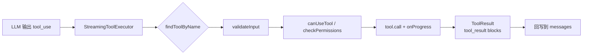
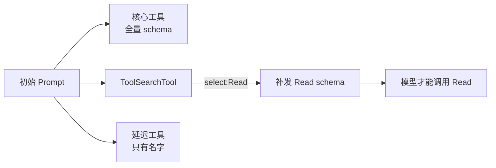
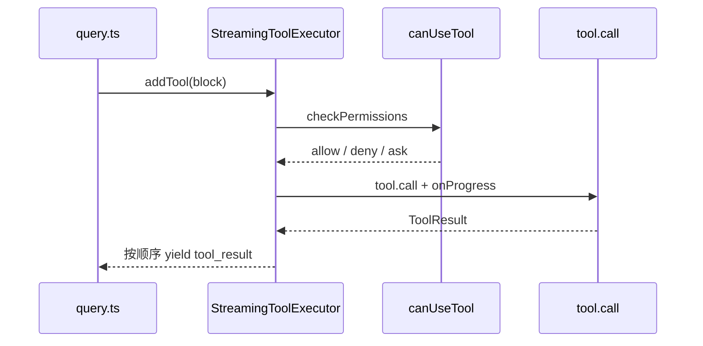
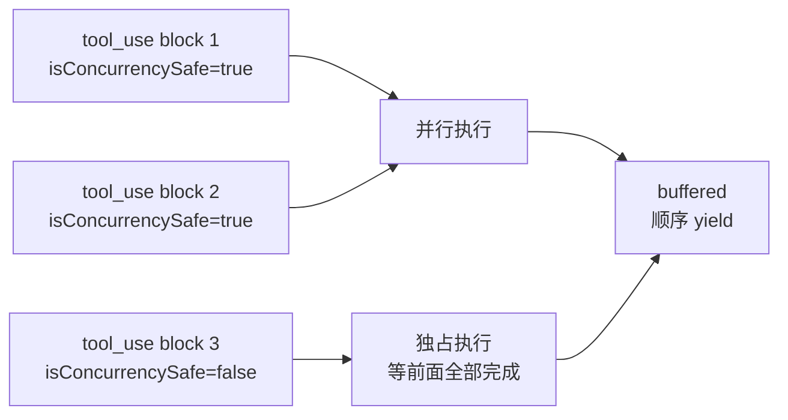

# Claude Code 工具系统 (Tool System) 概览

> 本篇是 Claude Code 工具系统的总览笔记，后续将针对典型工具做深入剖析。
>
> 源码根：`/Users/huanglin12/myspace/claude-code-source/src/`

---

## 1. 概述

Claude Code 的"工具系统"是整个 Agentic 能力的底座：模型每一次"想做事"（读文件、跑命令、搜索、启子 agent……）都是通过生成 `tool_use` 块，再由 CLI 宿主执行工具并回写 `tool_result`。

整体上可以看作 **两层架构**：

1. **工具协议层 (`Tool.ts`)**：定义统一的 `Tool<Input, Output, Progress>` 合约——输入 schema、权限检查、执行函数、渲染函数、流式进度等全部类型化在一起。
2. **工具实现层 (`src/tools/*`)**：约 40+ 内置工具实现该合约，再加上 MCP 动态工具、LSP 工具、Agent/Skill/Task 等高阶工具。

注册、筛选、合并由 `tools.ts` 收拢；执行调度由 `services/tools/StreamingToolExecutor.ts` 负责；权限决策由 `hooks/useCanUseTool.ts` 和 `utils/permissions/*` 完成。



---

## 2. Tool 接口定义

核心类型在 `Tool.ts:362-695`，完整签名（节选）：

```ts
export type Tool<
  Input extends AnyObject = AnyObject,
  Output = unknown,
  P extends ToolProgressData = ToolProgressData,
> = {
  readonly name: string
  aliases?: string[]
  readonly inputSchema: Input          // zod schema
  readonly inputJSONSchema?: ToolInputJSONSchema  // MCP 直给 JSON Schema

  call(args, context, canUseTool, parentMessage, onProgress?): Promise<ToolResult<Output>>
  description(input, options): Promise<string>
  prompt(options): Promise<string>     // 模型面向的 system-prompt 片段

  isEnabled(): boolean
  isConcurrencySafe(input): boolean    // 是否可并行
  isReadOnly(input): boolean
  isDestructive?(input): boolean

  validateInput?(input, ctx): Promise<ValidationResult>
  checkPermissions(input, ctx): Promise<PermissionResult>
  preparePermissionMatcher?(input): Promise<(pattern: string) => boolean>

  // 渲染
  renderToolUseMessage(input, opts): React.ReactNode
  renderToolResultMessage?(output, progress, opts): React.ReactNode
  renderToolUseProgressMessage?(progress, opts): React.ReactNode
  renderToolUseRejectedMessage?(...): React.ReactNode
  renderToolUseErrorMessage?(...): React.ReactNode

  // ToolSearch / 延迟加载
  readonly shouldDefer?: boolean
  readonly alwaysLoad?: boolean
  searchHint?: string

  // MCP 标记
  isMcp?: boolean
  isLsp?: boolean
  mcpInfo?: { serverName: string; toolName: string }

  maxResultSizeChars: number
  mapToolResultToToolResultBlockParam(content, toolUseID): ToolResultBlockParam
}
```

几点关键设计：

- **一切行为都挂在 Tool 对象上**：执行、权限、渲染、classifier、transcript 索引 (`extractSearchText`)、分组渲染 (`renderGroupedToolUse`) 全部是同一个接口的 method，避免散落。
- **`buildTool()` 填默认值** (`Tool.ts:757-792`)：`isEnabled`/`isReadOnly`/`checkPermissions` 等有 fail-closed 默认值，工具定义可只覆盖关心的部分。
- **`ToolUseContext`** (`Tool.ts:158-300`) 是执行时贯穿整个调用的"上帝对象"：它承载 `options.tools`、`abortController`、`readFileState`（文件读状态 LRU）、`setAppState`、`requestPrompt`（交互式权限提问）、`appendSystemMessage`、agent/subagent 标识等。子 agent 会通过 `createSubagentContext` 派生只读/受限的 context。
- **Progress 是一等公民**：`ToolCallProgress<P>` 让 Bash、WebSearch、Agent 等长耗时工具能流式吐出中间状态，UI 通过 `renderToolUseProgressMessage` 实时渲染。

---

## 3. 工具注册与加载

注册入口：`tools.ts:193-251` 的 `getAllBaseTools()`。这是**静态注册表**，但内部布满了条件开关：

- `process.env.USER_TYPE === 'ant'` → 内部（Anthropic 员工）独占工具：`ConfigTool`、`TungstenTool`、`REPLTool`、`SuggestBackgroundPRTool`
- `feature('KAIROS' / 'PROACTIVE' / 'AGENT_TRIGGERS' / …)` → GrowthBook 特性门控
- `hasEmbeddedSearchTools()` → ant 构建里 bfs/ugrep 直接嵌入 bun 二进制，`GlobTool`/`GrepTool` 被 Bash 内置替代，所以跳过
- `isTodoV2Enabled()` → 启用 `TaskCreate/Get/Update/List` 替代老 `TodoWrite`
- `isWorktreeModeEnabled()` → `EnterWorktreeTool` / `ExitWorktreeTool`
- `isPowerShellToolEnabled()` → Windows 下的 PowerShellTool

然后 `getTools(permissionContext)` (`tools.ts:271-327`) 在基础列表上做二次过滤：

1. `CLAUDE_CODE_SIMPLE` → 只保留 Bash / Read / Edit 精简集
2. `filterToolsByDenyRules` → 去掉被 deny rule 拉黑的工具（含 MCP 按 server 前缀批量 deny）
3. REPL 模式下隐藏被 REPL 内部 VM 包装的 primitive 工具
4. 最后按 `isEnabled()` 过滤

与 MCP 工具的合并在 `assembleToolPool` (`tools.ts:345-367`)：**built-in 排在前面**，MCP 排在后面，用 `uniqBy` 保证 built-in 在命名冲突时胜出。这个顺序非常关键——服务端 `claude_code_system_cache_policy` 在最后一个 built-in 之后打 prompt cache 断点，一旦顺序乱掉整条下游缓存就会失效。

### ToolSearch 延迟加载

当工具总量触发阈值（`isToolSearchEnabledOptimistic`），CLI 会把 `shouldDefer: true` 的工具从初始 prompt 里摘出来，只留一个 `ToolSearch` 元工具 (`src/tools/ToolSearchTool/ToolSearchTool.ts:1-80`)。

模型需要什么能力时：
- `ToolSearch(query: "select:Read,Edit")` 精确选取
- `ToolSearch(query: "slack send")` 关键词检索

被选中的工具的完整 schema 才被"补发"回模型的可用工具集。`isDeferredTool` 判定见 `tools/ToolSearchTool/prompt.ts:62-107`，主要条件就是 `tool.shouldDefer === true`（MCP 工具可通过 `_meta['anthropic/alwaysLoad']` 覆盖）。



---

## 4. 内置工具清单（约 40+）

按职责分组（以 `src/tools/` 子目录 + `tools.ts` 为准）：

### 4.1 文件 I/O
| 工具 | 职责 |
|---|---|
| `FileReadTool` | 读文件、图片、PDF、notebook；支持 offset/limit |
| `FileEditTool` | 精确字符串替换编辑 |
| `FileWriteTool` | 整文件写入/覆盖 |
| `NotebookEditTool` | Jupyter notebook cell 编辑 |

### 4.2 Shell / 执行
| 工具 | 职责 |
|---|---|
| `BashTool` | 核心执行工具，含 sandbox、权限、sed/find 特殊处理 |
| `PowerShellTool` | Windows 平台对应物 |
| `REPLTool` | ant-only，V8 VM 内执行 JS/TS 并封装基础工具调用 |

### 4.3 搜索
| 工具 | 职责 |
|---|---|
| `GlobTool` | 文件名 glob 匹配 |
| `GrepTool` | ripgrep 包装 |
| `WebSearchTool` | Web 搜索 |
| `WebFetchTool` | URL 抓取 + 抽取 |

### 4.4 Agent / Task / 协作
| 工具 | 职责 |
|---|---|
| `AgentTool` | 派生子 agent（Task 工具的底层） |
| `SkillTool` | 调用 Claude Skills |
| `TaskCreate/Get/Update/List/Stop/OutputTool` | Todo v2 任务跟踪 |
| `TodoWriteTool` | 老版 todo（被 v2 替代） |
| `TeamCreate/DeleteTool` | Agent Swarm 场景 |
| `SendMessageTool` | 多 agent 间消息 |

### 4.5 MCP / LSP / 外部
| 工具 | 职责 |
|---|---|
| `ListMcpResourcesTool` / `ReadMcpResourceTool` | MCP 资源列表/读取 |
| `McpAuthTool` | MCP 鉴权 |
| `MCPTool` | MCP 工具调用封装 |
| `LSPTool` | 基于 LSP 的代码导航 |

### 4.6 元 / 控制
| 工具 | 职责 |
|---|---|
| `ToolSearchTool` | 延迟工具发现 |
| `EnterPlanModeTool` / `ExitPlanModeTool` (V2) | Plan Mode 切换 |
| `EnterWorktreeTool` / `ExitWorktreeTool` | git worktree 模式 |
| `AskUserQuestionTool` | 结构化提问 |
| `BriefTool` | 简报回显 |
| `ConfigTool` | 读写配置（ant-only）|
| `TungstenTool` | ant-only 评估/诊断 |
| `SleepTool` | 等待 / 周期性触发 |
| `ScheduleCronTool` (Create/Delete/List) | 定时任务 |
| `RemoteTriggerTool` | 远程触发 |
| `SyntheticOutputTool` | 合成输出（测试/占位）|
| `TestingPermissionTool` | 仅 NODE_ENV=test |

---

## 5. 工具执行流程

### 5.1 主流程（精简版）



### 5.2 并发模型



要点：

- **并发安全判定**：`isConcurrencySafe(input)` 为 true 的工具可并行；写操作（Bash 写、FileWrite 等）为 false，独占执行（`StreamingToolExecutor.ts:40-62`）
- **顺序输出**：不论执行顺序，`tool_result` 严格按 `tool_use` 插入顺序回写，保证模型历史确定性
- **siblingAbortController**：任一工具出错会 abort 同批其他工具，但不影响父 controller
- **未知工具**：`findToolByName` 找不到时合成 `<tool_use_error>No such tool available</tool_use_error>` 返回模型，不中断主循环（`StreamingToolExecutor.ts:76-100`）
- **streaming fallback 时**：executor 标记 `discarded`，in-progress 工具收到合成错误，主循环整轮重跑

---

## 6. 流式工具执行 (StreamingToolExecutor)

`src/services/tools/StreamingToolExecutor.ts` 是这套流水线的心脏。它维护一个 `TrackedTool[]` 队列，每个条目带 `status: queued | executing | completed | yielded`。

- **addTool(block, assistantMessage)**：把新来的 `tool_use` 放入队列，若并发约束允许立即启动。
- **getRemainingResults()**：async generator，按插入顺序 yield 已完成工具的结果 / 中间 progress。用 `progressAvailableResolve` 作唤醒信号，避免忙等。
- **contextModifiers**：非并发安全的工具可通过返回 `ToolResult.contextModifier` 修改后续工具的 context（典型如 `cd` 改 cwd）。
- **canUseTool 注入**：构造时把 `CanUseToolFn` 存下来，执行阶段传给 `runToolUse` → `tool.call`。这样权限决策点贴近执行，便于中途 ask-user。

这种设计让 "LLM 一边流式输出 tool_use、另一边工具就开始跑" 成为可能，明显缩短端到端延迟，尤其是 Bash + 并行搜索组合的场景。

---

## 7. 权限系统集成

权限流程分三层：

1. **静态 deny filter**：`filterToolsByDenyRules` 在工具被交给模型前就摘掉黑名单里的工具（`tools.ts:262-269`）。
2. **`tool.validateInput` + `tool.checkPermissions`**：每个工具自定义"这组参数允许吗"，例如 `BashTool` 的命令解析 + 沙箱判断、`FileReadTool` 的路径白名单 (`utils/permissions/filesystem.ts`)。返回 `PermissionResult`：`allow` / `ask` / `deny` / `updatedInput`。
3. **`canUseTool` (hook)**：`hooks/useCanUseTool.ts` 是 REPL/SDK 模式下真正和用户交互的入口。它会：
   - 查 `alwaysAllowRules` / `alwaysDenyRules` / `alwaysAskRules` (按 session / project / user 三级来源)
   - 跑 PreToolUse hooks（用户自定义 shell 钩子）
   - 交给 `interactiveHandler` 弹出权限对话框
   - 记录拒绝次数 `DenialTrackingState`，连续拒绝会降级到强提示模式

`PermissionMode` (`types/permissions.ts`) 有 `default` / `acceptEdits` / `bypassPermissions` / `plan` / `auto` 等。`ToolPermissionContext` 是 `DeepImmutable`，确保规则集在一次调用内不被偷改 (`Tool.ts:123-138`)。

`requireCanUseTool` 是一个特殊 flag：即便 hook 自动放行，也强制走 `canUseTool`——speculation 用它做 overlay 文件路径重写。

---

## 8. 典型工具剖析

### 8.1 BashTool（非并发安全的代表）

位于 `src/tools/BashTool/`，文件众多：

- `BashTool.tsx`：工具主体
- `bashPermissions.ts` / `bashSecurity.ts`：权限和安全检查
- `commandSemantics.ts`：命令语义分析（判断是否 read-only、search、destructive）
- `shouldUseSandbox.ts`：是否进 sandbox 子进程
- `sedEditParser.ts` / `sedValidation.ts`：sed 专门的写操作拦截
- `readOnlyValidation.ts` / `modeValidation.ts`：按权限模式过滤
- `prompt.ts`：给 LLM 的使用说明
- `BashToolResultMessage.tsx` / `UI.tsx`：渲染

`isConcurrencySafe` 仅对明确 read-only 的命令返回 true（基于 `commandSemantics`），否则强制串行。`preparePermissionMatcher` 解析 `Bash(git *)` 这种规则模式，供 hook `if` 条件使用。

### 8.2 FileReadTool（偏纯函数的代表）

`src/tools/FileReadTool/FileReadTool.ts` 一个文件基本搞定，分支很少但兼容度极高：

- 通过扩展名 + magic bytes 判断：text / binary / image / PDF / notebook
- 图像：`imageResizer.ts` 压缩到 token 预算内
- PDF：`extractPDFPages` + 按页读取
- Notebook：`mapNotebookCellsToToolResult` 整合 cell 输出
- `limits.ts` 定义默认 maxTokens/maxSizeBytes，可被 `ctx.fileReadingLimits` 覆盖
- `readFileState` (LRU) 记录 mtime，配合 `FileEditTool` 的 "必须先 Read 再 Edit" 约束
- `maxResultSizeChars = Infinity`：结果绝不落盘转存（否则会形成 Read→file→Read 循环）

---

## 9. 相关文件索引

| 主题 | 路径 |
|---|---|
| Tool 合约 | `/Users/huanglin12/myspace/claude-code-source/src/Tool.ts` |
| 工具注册 / 过滤 / 合并 | `/Users/huanglin12/myspace/claude-code-source/src/tools.ts` |
| 流式执行器 | `/Users/huanglin12/myspace/claude-code-source/src/services/tools/StreamingToolExecutor.ts` |
| 单工具执行 (runToolUse) | `/Users/huanglin12/myspace/claude-code-source/src/services/tools/toolExecution.ts` |
| 权限 hook | `/Users/huanglin12/myspace/claude-code-source/src/hooks/useCanUseTool.ts` |
| 权限规则 | `/Users/huanglin12/myspace/claude-code-source/src/utils/permissions/` |
| 交互式权限对话 | `/Users/huanglin12/myspace/claude-code-source/src/hooks/toolPermission/handlers/interactiveHandler.ts` |
| ToolSearch（延迟加载） | `/Users/huanglin12/myspace/claude-code-source/src/tools/ToolSearchTool/` |
| BashTool | `/Users/huanglin12/myspace/claude-code-source/src/tools/BashTool/` |
| FileReadTool | `/Users/huanglin12/myspace/claude-code-source/src/tools/FileReadTool/FileReadTool.ts` |
| 所有内置工具目录 | `/Users/huanglin12/myspace/claude-code-source/src/tools/` |
| 进度类型 / permission 类型 | `/Users/huanglin12/myspace/claude-code-source/src/types/tools.ts`, `types/permissions.ts` |
| 主查询循环调用点 | `/Users/huanglin12/myspace/claude-code-source/src/query.ts` |

---

## 小结

Claude Code 工具系统的精髓在于**一个统一接口 + 一个流式执行器 + 一套分层权限**：

- `Tool` 接口把"执行 / 权限 / 渲染 / 分析 / 缓存提示"拧到一起，新增工具几乎只要写一个文件；
- `getAllBaseTools` 以"特性门控 + 环境变量"的方式做静态注册，再配合 `ToolSearch` 实现延迟加载，避免 prompt 爆炸；
- `StreamingToolExecutor` 让流式 tool_use 能边生边执行，同时维持顺序输出；
- `canUseTool` + deny filter + `checkPermissions` 三层嵌套的权限策略，是 Claude Code 相对其他 CLI agent 最讲究的部分之一。

后续可针对 `BashTool`（安全/沙箱）、`AgentTool`（子 agent 生成）、`ToolSearchTool`（工具动态发现）、权限系统分别做专题笔记。
