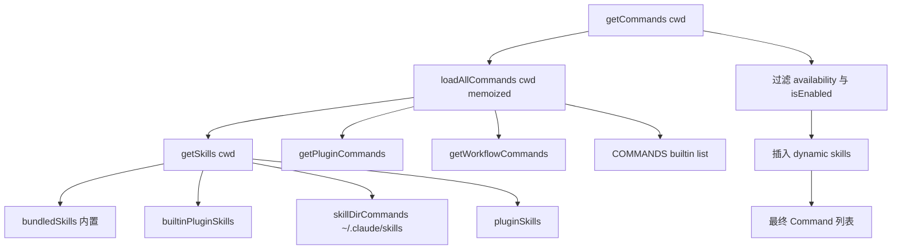
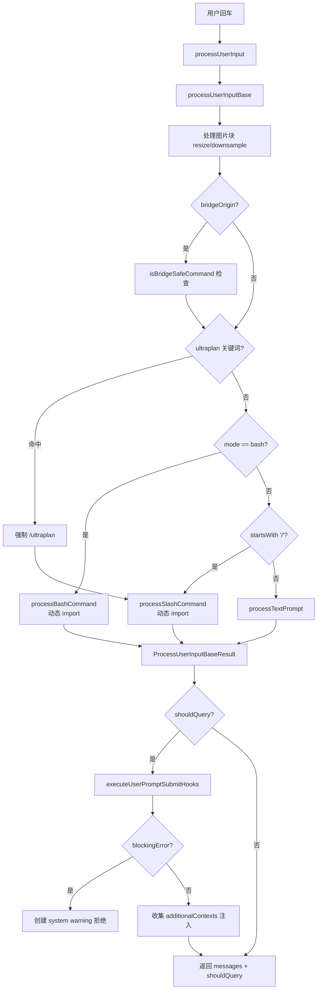
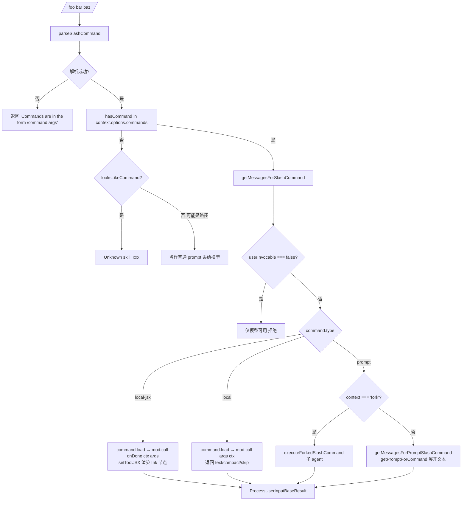

# 03 Slash Commands 与用户输入处理

> 研究目标：理解 Claude Code CLI 如何把用户在 TUI 输入框里敲下的一行字，分发成普通 prompt、bash 命令、或 slash 命令，并掌握整个 Command 注册表的结构。
>
> 源码位置：`/Users/huanglin12/myspace/claude-code-source/src/`

---

## 1. 概述

用户在 Claude Code 输入框里敲下的内容并不是一视同仁的。系统会根据 **前缀** 做三路分发：

- `!` 开头 → bash 模式，走 `processBashCommand`（执行 shell 并把输出作为上下文塞给模型）
- `/` 开头 → slash 命令，走 `processSlashCommand`（从命令注册表里查找并执行）
- 其它 → 普通 prompt，走 `processTextPrompt`（打包成 UserMessage 发给模型）

Slash 命令本身又分为 **三种类型**（union 定义在 `src/types/command.ts`）：

| type | 执行语义 | 典型例子 |
| --- | --- | --- |
| `prompt` | 命令被展开成一段 **prompt 文本**，塞入对话交给模型继续处理 | `/commit`、`/review`、`/insights`、所有 Skill |
| `local` | 命令在 CLI **本地同步执行**，返回纯文本结果放进 `<local-command-stdout>` | `/compact`、`/cost`、`/clear` |
| `local-jsx` | 命令 **渲染一个 Ink React 组件**，占用终端做交互式 UI（选择器/表单） | `/help`、`/config`、`/model`、`/login` |

所有命令都通过 **动态 `import()` 懒加载**（`load: () => import('./xxx.js')`），目的是让 CLI 的冷启动时间不被 100+ 个命令的依赖拖慢。`commands.ts` 里的 `insights` 尤其典型——注释说该文件 113KB / 3200 行，所以用一个"shim 包装器"把真实模块延迟到被调用时才加载（见 `commands.ts:190-202`）。

---

## 2. Command 类型定义

核心定义在 `src/types/command.ts`：

```ts
// src/types/command.ts:205
export type Command = CommandBase &
  (PromptCommand | LocalCommand | LocalJSXCommand)
```

三个分支的关键字段：

```ts
// src/types/command.ts:25
export type PromptCommand = {
  type: 'prompt'
  progressMessage: string
  contentLength: number
  source: SettingSource | 'builtin' | 'mcp' | 'plugin' | 'bundled'
  context?: 'inline' | 'fork'   // fork 表示在子 agent 里跑
  agent?: string
  hooks?: HooksSettings          // Skill 级别的 hook
  paths?: string[]               // glob，触碰匹配文件后才出现
  getPromptForCommand(args, ctx): Promise<ContentBlockParam[]>
}

// src/types/command.ts:74
type LocalCommand = {
  type: 'local'
  supportsNonInteractive: boolean
  load: () => Promise<LocalCommandModule>   // 动态导入
}

// src/types/command.ts:144
type LocalJSXCommand = {
  type: 'local-jsx'
  load: () => Promise<LocalJSXCommandModule>
}
```

`CommandBase`（`command.ts:175`）里还挂了很多通用元数据：`name`、`aliases`、`description`、`isEnabled()`、`availability`（`claude-ai` / `console` 鉴权门槛）、`loadedFrom`（`bundled` / `skills` / `plugin` / `mcp` / `managed`）、`disableModelInvocation`、`userInvocable` 等。这一层决定了命令是 **只有用户可以手敲 `/xxx` 触发**，还是 **模型也可以通过 SkillTool 触发**。

---

## 3. 命令注册与加载

注册表入口是 `src/commands.ts`，它不只是一个静态数组。加载分成几层：



关键点：

1. **内置命令（builtin）** 在 `commands.ts` 顶部用 ESM `import` 全部静态引入（`commands.ts:1-205`），然后装进 `COMMANDS = memoize(() => [...])`（`commands.ts:258-346`）。之所以包一层函数是因为里面有些命令要读 config，而模块初始化阶段 config 还没加载。

2. **用户命令 / Skill** 来自 `~/.claude/commands/`、`~/.claude/skills/`，通过 `getSkillDirCommands(cwd)` 读盘并解析（`commands.ts:353-398`）。这些是 Markdown + frontmatter 格式的 prompt 命令。

3. **插件命令** 通过 `getPluginCommands()` 从 `~/.claude/plugins/` 加载（`utils/plugins/loadPluginCommands.ts`）。

4. **Bundled skills** 来自 `src/skills/bundledSkills.ts`，跟 CLI 一起打包发布。

5. **Workflow 命令** 受 feature flag `WORKFLOW_SCRIPTS` 控制，动态 require。

6. **Dynamic skills** 是一个有意思的机制：当模型读到某个文件时，满足 `paths: [...]` glob 的 skill 会**临时注入**到命令列表，实现"按需发现"能力（`commands.ts:480-516`）。

7. **权限过滤** 在 `getCommands` 末尾每次都重新跑（`commands.ts:483-485`），因为 `/login`、`/logout` 会改变 `isClaudeAISubscriber()` 的返回值：

   ```ts
   // commands.ts:417
   export function meetsAvailabilityRequirement(cmd: Command): boolean
   ```

8. **远程/Bridge 白名单**：`REMOTE_SAFE_COMMANDS`（`commands.ts:619`）和 `BRIDGE_SAFE_COMMANDS`（`commands.ts:651`）用来限制在 `--remote` 模式或手机/网页 Bridge 里能执行哪些命令。`local-jsx` 类型永远被禁（因为要画 Ink UI），`prompt` 类型永远放行，`local` 类型显式白名单。

9. **Feature-flag 条件编译**：`commands.ts:60-123` 大量使用 `feature('KAIROS')`、`feature('BRIDGE_MODE')`、`feature('ULTRAPLAN')` 等 `bun:bundle` 标志位，配合 `require()` 实现 dead-code elimination，外部构建里这些命令直接被打包器剪掉。

10. **INTERNAL_ONLY_COMMANDS**（`commands.ts:225-254`）是只有 Anthropic 内部 / `USER_TYPE=ant` 用户才看得到的命令集合（`commit`、`bughunter`、`issue` 等）。

---

## 4. 用户输入分发流程

入口：`src/utils/processUserInput/processUserInput.ts`。



几个细节：

- **`processUserInput` 本身很薄**，主要职责是先调 `processUserInputBase` 拿到 `{messages, shouldQuery}`，然后跑 `UserPromptSubmit` hook 链（`processUserInput.ts:153-264`）。
- **`processUserInputBase`** 才是真正的分发器，长度约 300 行（`processUserInput.ts:281-589`）：
  1. 处理图像 block（`maybeResizeAndDownsampleImageBlock`）
  2. Bridge 安全检查（`processUserInput.ts:428-453`）：如果是从手机 / Remote Control 发来的消息而且是 `/xxx`，必须是 `isBridgeSafeCommand` 才放行；否则回一句 "isn't available over Remote Control"
  3. `ULTRAPLAN` 关键词劫持：如果输入里包含某关键词就强制改写成 `/ultraplan ...`（`processUserInput.ts:467-493`）
  4. `mode === 'bash'` → `processBashCommand`
  5. `inputString.startsWith('/')` → `processSlashCommand`
  6. 兜底 → `processTextPrompt`
- **三个 process 函数都是动态 `import()`** 进来的：

  ```ts
  // processUserInput.ts:518, 538
  const { processBashCommand } = await import('./processBashCommand.js')
  const { processSlashCommand } = await import('./processSlashCommand.js')
  ```

  这是纯启动性能考量——交互式 TUI 初始化时根本不需要这些分支的依赖。
- **`processTextPrompt` 是唯一同步导入的**（`processUserInput.ts:61`），因为普通对话是最常走的路径。

---

## 5. Slash 命令执行流程

进入 `processSlashCommand(inputString, ..., context)`（`processSlashCommand.tsx:309`）之后：



三种 type 的落地代码（`processSlashCommand.tsx:550-761`）：

- **`local-jsx`**：用 `new Promise` + `onDone` 回调模式封装了 React 生命周期。`mod.call(onDone, ctx, args)` 异步返回 JSX，然后 `setToolJSX({jsx, shouldHidePromptInput: true})` 把节点挂到 REPL 的"工具显示层"上。用户在 UI 里交互完成后调 `onDone(resultText, {display, shouldQuery})` 让 Promise resolve。特别小心地处理了 "onDone 先于 JSX 返回被调用" 的竞态（`:622-636`）。
- **`local`**：最简单，直接 `await mod.call(args, context)`，结果包进 `<local-command-stdout>...</local-command-stdout>` 作为 system 消息显示。特殊分支 `result.type === 'compact'` 会走 `buildPostCompactMessages` 重写整段对话历史。
- **`prompt`**：调 `command.getPromptForCommand(args, ctx)` 拿到 `ContentBlockParam[]`，然后包成 UserMessage，设 `shouldQuery: true` 交给主循环走一次模型调用。如果命令标了 `context: 'fork'`，则改走 `executeForkedSlashCommand` 开独立 sub-agent（`processSlashCommand.tsx:62-307`）。

---

## 6. 典型命令剖析

### 6.1 `/commit` — 纯 prompt 命令（builtin，内部可见）

`src/commands/commit.ts` 才 92 行，很适合拿来示范 `prompt` 类型的样貌：

```ts
// src/commands/commit.ts:57
const command = {
  type: 'prompt',
  name: 'commit',
  description: 'Create a git commit',
  allowedTools: ['Bash(git add:*)', 'Bash(git status:*)', 'Bash(git commit:*)'],
  contentLength: 0,
  progressMessage: 'creating commit',
  source: 'builtin',
  async getPromptForCommand(_args, context) {
    const promptContent = getPromptContent()
    // 在 prompt 字符串里嵌入 !`git status` 这样的占位符，
    // 这里先执行 shell 把结果替换进去（让模型看到当前仓库状态）
    const finalContent = await executeShellCommandsInPrompt(
      promptContent,
      { ...context, getAppState() { /* 注入 allowedTools */ } },
      '/commit',
    )
    return [{ type: 'text', text: finalContent }]
  },
} satisfies Command
```

亮点：

- `getPromptContent()` 返回一段包含 `!\`git status\``、`!\`git diff HEAD\`` 等占位符的 Markdown；
- `executeShellCommandsInPrompt` 负责识别 `!\`...\`` 标记，真的去跑命令，把 stdout 替换回去，于是模型看到的 prompt 里已经带上了"本仓库当前状态"；
- 通过在 `allowedTools` 里 pin 住 `Bash(git commit:*)` 等，让主循环在这一次对话里自动批准这几个 Bash 调用，不用再问用户。

### 6.2 `/compact` — local 命令

`src/commands/compact/index.ts`：

```ts
const compact = {
  type: 'local',
  name: 'compact',
  description: 'Clear conversation history but keep a summary in context. ...',
  isEnabled: () => !isEnvTruthy(process.env.DISABLE_COMPACT),
  supportsNonInteractive: true,
  argumentHint: '<optional custom summarization instructions>',
  load: () => import('./compact.js'),   // 懒加载
} satisfies Command
```

真正的实现在 `./compact.js`，只有被调用时才会 import。返回的 `LocalCommandResult` 走特殊分支 `result.type === 'compact'`（`processSlashCommand.tsx:679`），让系统用 `buildPostCompactMessages` 重建消息数组——这是 Claude Code "上下文压缩" 的入口。

### 6.3 `/help` — local-jsx 命令

`src/commands/help/index.ts`：

```ts
const help = {
  type: 'local-jsx',
  name: 'help',
  description: 'Show help and available commands',
  load: () => import('./help.js'),
} satisfies Command
```

`./help.tsx` 返回一个 Ink 组件，被 `setToolJSX` 挂到 REPL，用户按 Esc / Enter 完成交互后调 `onDone()` 关闭。这是 `/config`、`/model`、`/login`、`/theme` 等所有"交互式设置面板"的共同模式。

---

## 7. UserPromptSubmit Hook 注入点

`processUserInput` 的后半段（`processUserInput.ts:178-264`）跑一条 hook 链：

```ts
for await (const hookResult of executeUserPromptSubmitHooks(
  inputMessage,
  appState.toolPermissionContext.mode,
  context,
  context.requestPrompt,
)) {
  if (hookResult.blockingError) {
    return { messages: [createSystemMessage(blockingMessage, 'warning')],
             shouldQuery: false }
  }
  if (hookResult.preventContinuation) { /* 停止 */ }
  if (hookResult.additionalContexts) {
    // 作为 attachment 注入到这一轮对话
    result.messages.push(createAttachmentMessage({
      type: 'hook_additional_context',
      content: hookResult.additionalContexts.map(applyTruncation),
      hookName: 'UserPromptSubmit',
      hookEvent: 'UserPromptSubmit',
    }))
  }
}
```

这意味着 `settings.json` 里配置的 `UserPromptSubmit` hook 有三种能力：

1. **拦截**（`blockingError`）—— 直接拒绝这次输入，向用户显示 warning，原 prompt 不入对话；
2. **软停**（`preventContinuation`）—— 保留原 prompt 在对话里，但不触发模型调用；
3. **注入上下文**（`additionalContexts`）—— 最常用，把额外信息（当前分支、工单号、安全提醒等）塞给模型。单次 hook 输出超过 `MAX_HOOK_OUTPUT_LENGTH = 10000` 字符会被截断（`processUserInput.ts:272-279`）。

注意 hook 只在 `result.shouldQuery === true` 的路径上跑，所以 `local` / `local-jsx` 这类纯本地命令不会触发 UserPromptSubmit hook —— 它们根本不经过模型。

---

## 8. 相关文件索引

**注册表与类型**
- `/Users/huanglin12/myspace/claude-code-source/src/commands.ts` — 命令注册表、`getCommands`、`REMOTE_SAFE_COMMANDS`、`BRIDGE_SAFE_COMMANDS`、`findCommand`、`getCommand`
- `/Users/huanglin12/myspace/claude-code-source/src/types/command.ts` — `Command` union、`PromptCommand` / `LocalCommand` / `LocalJSXCommand`、`CommandBase`、`CommandAvailability`

**输入分发器**
- `/Users/huanglin12/myspace/claude-code-source/src/utils/processUserInput/processUserInput.ts` — `processUserInput` / `processUserInputBase`
- `/Users/huanglin12/myspace/claude-code-source/src/utils/processUserInput/processSlashCommand.tsx` — slash 命令调度、三种 type 的执行落地、forked 子 agent 模式
- `/Users/huanglin12/myspace/claude-code-source/src/utils/processUserInput/processBashCommand.tsx` — `!` 前缀 bash 处理
- `/Users/huanglin12/myspace/claude-code-source/src/utils/processUserInput/processTextPrompt.ts` — 普通 prompt 打包

**辅助**
- `/Users/huanglin12/myspace/claude-code-source/src/utils/slashCommandParsing.ts` — `parseSlashCommand`（把 `/foo:bar baz` 拆成 `commandName + args + isMcp`）
- `/Users/huanglin12/myspace/claude-code-source/src/utils/hooks.ts` — `executeUserPromptSubmitHooks`、`getUserPromptSubmitHookBlockingMessage`
- `/Users/huanglin12/myspace/claude-code-source/src/utils/promptShellExecution.ts` — `executeShellCommandsInPrompt`，把 prompt 里的 `` !`cmd` `` 占位符替换成 shell 输出
- `/Users/huanglin12/myspace/claude-code-source/src/skills/bundledSkills.ts` — 随 CLI 打包的 skills
- `/Users/huanglin12/myspace/claude-code-source/src/skills/loadSkillsDir.ts` — 从 `~/.claude/skills/` 扫描加载
- `/Users/huanglin12/myspace/claude-code-source/src/utils/plugins/loadPluginCommands.ts` — 插件命令加载

**代表性命令样本**
- `/Users/huanglin12/myspace/claude-code-source/src/commands/commit.ts` — `prompt` 类型，内部可见
- `/Users/huanglin12/myspace/claude-code-source/src/commands/compact/index.ts` + `compact.ts` — `local` 类型
- `/Users/huanglin12/myspace/claude-code-source/src/commands/help/index.ts` + `help.tsx` — `local-jsx` 类型
- `/Users/huanglin12/myspace/claude-code-source/src/commands/createMovedToPluginCommand.ts` — 命令迁移到插件后的占位兼容
