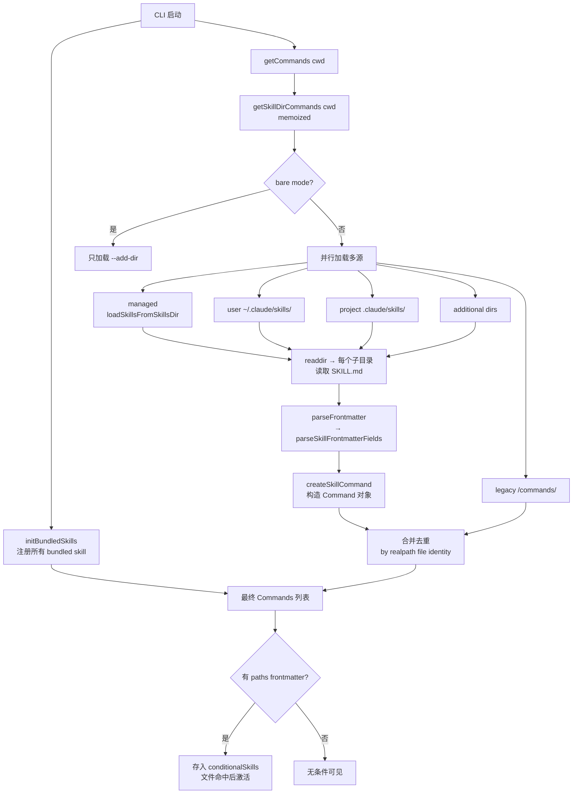

# 04 Skills 系统

> 源码路径：`src/skills/`、`src/tools/SkillTool/`
> 核心职责：**可复用的、按需加载的 Prompt 片段 + 工具权限 + 元数据**，由模型（或用户）主动触发注入到对话中。

---

## 1. 概述

**Skill（技能）** 是 Claude Code 中一种"按需注入专家知识"的机制。它本质上是一份带 frontmatter 的 Markdown 文件（`SKILL.md`），在对话运行中通过 `SkillTool` 被加载，把完整内容作为 user message 注入主循环 —— 等同于用户"手动把 SKILL.md 粘贴进对话"。

与其它概念的区别：

| 概念 | 本质 | 谁触发 | 运行空间 |
|---|---|---|---|
| **Skill** | Markdown + frontmatter，注入 prompt | 模型（Skill 工具调用）或用户（slash command） | 主循环 inline，或 forked 子 agent |
| **Agent（SubAgent）** | 独立上下文、独立 system prompt 的子 agent | 通过 AgentTool 显式派发 | 必然 fork 子会话 |
| **Command（Slash Command）** | 历史概念，现已统一到 Skill 体系 | 用户输入 `/xxx` | 同 Skill |

关键设计点：
- **懒加载**：skill 的 prompt 正文只在触发时才读入，平时 SkillTool 只把 `name + description + whenToUse` 列在系统消息里供模型"挑选"（`src/tools/SkillTool/prompt.ts:21` 的 `SKILL_BUDGET_CONTEXT_PERCENT = 0.01`，只占上下文窗口 1%）。
- **统一抽象**：`Command` 是 Skill、bundled skill、legacy /commands、MCP skill 的共同类型（`src/types/command.ts`），由 `getCommands()` 聚合。
- **与主循环解耦**：SkillTool 通过返回 `newMessages + contextModifier`，由 Agent 主循环把 skill 正文追加进消息列表并可选地修改权限/模型。

---

## 2. Skill 类型

根据 `loadedFrom` 字段（`src/skills/loadSkillsDir.ts:67`）：

```ts
export type LoadedFrom =
  | 'commands_DEPRECATED'  // 旧 /commands/ 目录（兼容）
  | 'skills'               // 文件系统 /skills/ 目录
  | 'plugin'               // 插件带来的 skill
  | 'managed'              // 政策/企业管控
  | 'bundled'              // CLI 二进制内置
  | 'mcp'                  // MCP server 暴露的 prompt
```

对应的来源目录（`src/skills/loadSkillsDir.ts:78` `getSkillsPath`）：

- **bundled**：`src/skills/bundled/*.ts`，在 `initBundledSkills()` 启动时注册到内存。
- **user**：`~/.claude/skills/<skill-name>/SKILL.md`
- **project**：`<repo>/.claude/skills/<skill-name>/SKILL.md`（沿父目录向上遍历到 HOME）
- **managed/policy**：`<ManagedFilePath>/.claude/skills/...`（企业策略）
- **plugin**：插件包带来的目录
- **mcp**：MCP server 在运行时暴露的 prompt（`mcpSkillBuilders.ts` 做解耦注册）
- **additional**：`--add-dir` 参数指定的额外工作目录下的 `.claude/skills/`

所有文件型 skill **只支持目录格式** `skill-name/SKILL.md`，单个 `.md` 文件在 `/skills/` 下会被忽略（`loadSkillsDir.ts:424-445`）。

---

## 3. Skill 加载流程



关键函数（`loadSkillsDir.ts`）：
- `getSkillDirCommands` `:638` —— memoized 总入口，并行加载五路来源
- `loadSkillsFromSkillsDir` `:407` —— 扫描单个 `/skills/` 目录
- `parseSkillFrontmatterFields` `:185` —— 解析 frontmatter 所有字段
- `createSkillCommand` `:270` —— 构造统一的 `Command` 对象，并生成 `getPromptForCommand` 闭包

**去重策略**：通过 `realpath()` 取 canonical file identity，防止符号链接或父目录重叠导致同一 SKILL.md 被多源加载（`:728-763`）。

**条件 skill（paths frontmatter）**：带 `paths: ...` 的 skill 只有当 Edit/Read 命中匹配路径时才被激活进入 SkillTool 列表，用于降低无关 skill 的 token 成本。

---

## 4. SKILL.md 格式 + frontmatter 字段

一份典型的 SKILL.md：

```markdown
---
name: my-skill
description: 一句话描述，用于 SkillTool 列表
when_to_use: 详细的触发时机说明（可选）
allowed-tools: [Read, Edit, Bash]
argument-hint: "[filename]"
arguments: ["filename"]
model: sonnet
disable-model-invocation: false
user-invocable: true
context: fork
agent: my-agent
paths: "src/**/*.ts"
hooks:
  PreToolUse:
    - matcher: Bash
      hooks: [...]
version: "1.0"
effort: medium
shell: bash
---

这里是 skill 正文（Markdown）。
可以用 ${CLAUDE_SKILL_DIR} 引用本 skill 的基目录。
可以用 ${CLAUDE_SESSION_ID} 引用会话 ID。
可以用 !`shell 命令` 做 shell 注入（非 MCP 来源）。
```

所有字段的解析都在 `parseSkillFrontmatterFields`（`loadSkillsDir.ts:185-265`）。主要字段：

| 字段 | 说明 | 默认 |
|---|---|---|
| `name` | 显示名（目录名优先作为实际 name） | 目录名 |
| `description` | 简短描述，缺失时从 markdown 首段抽取 | auto |
| `when_to_use` | 触发场景说明，仅用于 SkillTool 列表提示 | - |
| `allowed-tools` | 此 skill 执行时自动 allow 的工具列表 | `[]` |
| `argument-hint` / `arguments` | slash command 参数提示与命名参数 | - |
| `model` | 指定模型（`inherit` / `sonnet` / `opus` ...） | 继承 |
| `disable-model-invocation` | 为 true 时模型不能通过 SkillTool 调用 | false |
| `user-invocable` | 是否允许用户以 `/name` 方式触发 | true |
| `context` | `fork`（派发到子 agent）或 inline（默认） | inline |
| `agent` | fork 时使用的 agent 配置 | - |
| `paths` | 条件 skill 的路径匹配模式（ignore 库语法） | - |
| `hooks` | skill 激活期间追加的 hooks | - |
| `effort` | 思考努力等级（`low/medium/high/...`） | - |
| `shell` | 自定义 shell 解释器 | - |
| `version` | 版本字符串 | - |

`getPromptForCommand` 生成最终注入文本时会依次做：
1. 若有 `baseDir` → 前缀 `Base directory for this skill: <dir>\n\n`（`:344-347`）
2. `substituteArguments` 替换 `$1 / $ARGUMENTS / 命名参数`
3. 替换 `${CLAUDE_SKILL_DIR}` 和 `${CLAUDE_SESSION_ID}`
4. 非 MCP 来源执行 markdown 里的 `!shell` 内联命令（`executeShellCommandsInPrompt`）
5. 返回 `[{type: 'text', text: finalContent}]`

> 安全注意：MCP skill 被明确禁止执行 `!shell` 注入（`:374-396`），因为 MCP 来源被视为不可信远端。

---

## 5. SkillTool（模型/用户触发 skill）

`src/tools/SkillTool/SkillTool.ts` 中的 `SkillTool` 是一个标准 Tool，但它的作用特殊 —— 它是 **Skill 进入 agent 主循环的唯一模型侧入口**。

**输入 schema**（`SkillTool.ts:291-298`）：

```ts
z.object({
  skill: z.string(),            // skill name, 如 "commit" / "review-pr"
  args: z.string().optional(),  // 可选参数字符串
})
```

**工具 prompt**（`prompt.ts:173-195`）对模型说明：
- 当用户提及 `/xxx` 或请求与某 skill 匹配时 → **必须先调用 SkillTool 再回答**
- 可用 skill 清单会在 system-reminder 中动态注入
- 不要用 SkillTool 调用 `/help`、`/clear` 这类纯 CLI 内置命令

**Skill 列表是如何塞进 prompt 的？**
- `formatCommandsWithinBudget`（`prompt.ts:70`）在 1% 上下文预算内打包 `name + description + whenToUse`
- bundled skill **永远保留完整 description**，其它 skill 在预算紧张时按 `MAX_LISTING_DESC_CHARS=250` 截断，极端情况下降级为"仅名字"

**权限检查**（`SkillTool.ts:432-577` `checkPermissions`）：
- 先匹配 deny rules（支持 `skill-name` 精确与 `prefix:*` 前缀）
- 再匹配 allow rules
- 如果 skill 只使用"安全属性"（`skillHasOnlySafeProperties`）→ 自动 allow
- 否则 `ask` 用户，提供两条建议规则（精确 + 前缀）

---

## 6. Skill 执行流程 —— 从触发到注入 prompt

```mermaid
sequenceDiagram
    participant M as Model
    participant ST as SkillTool
    participant CMD as findCommand
    participant GP as getPromptForCommand
    participant Loop as Agent 主循环

    M->>ST: tool_use { skill:"commit", args:"-m fix" }
    ST->>ST: validateInput 校验 name + disableModelInvocation
    ST->>ST: checkPermissions (allow/deny/ask)

    alt context === "fork"
        ST->>ST: executeForkedSkill
        ST->>ST: runAgent 独立子上下文
        ST-->>M: {status:"forked", result}
    else inline (默认)
        ST->>CMD: 查找 command
        ST->>GP: processPromptSlashCommand<br/>→ getPromptForCommand(args)
        GP->>GP: 注入 baseDir 前缀<br/>替换变量 / 执行 !shell
        GP-->>ST: ContentBlockParam[] (skill 正文)
        ST->>ST: 打包成 UserMessage(s)<br/>tagMessagesWithToolUseID
        ST-->>Loop: { newMessages, contextModifier }
        Loop->>Loop: 追加 newMessages 到对话<br/>contextModifier 修改权限/模型/effort
        Loop->>M: 继续采样（带着 skill 正文）
    end
```

**inline 路径要点**（`SkillTool.ts:580-841`）：
- `newMessages` 是构造好的 user/attachment/system 消息，主循环直接写入对话历史
- `contextModifier` 是一个函数，可在后续每次采样时动态修改 context：
  - 把 `allowedTools` 合并进 `alwaysAllowRules.command`
  - 若 skill 指定了 `model` → 覆盖 `mainLoopModel`（并保留 `[1m]` 长窗口后缀）
  - 若指定了 `effort` → 覆盖 `effortValue`
- `recordSkillUsage` 记录使用频次，用于后续排序/推荐
- `addInvokedSkill` 标记 skill 已激活，hooks 注册逻辑在此判定

**fork 路径要点**（`SkillTool.ts:122-289` `executeForkedSkill`）：
- 创建独立 `agentId`，在子 agent 上下文里跑 skill 正文
- 返回 `{status:'forked', agentId, result}`，避免污染主对话 token

---

## 7. 内置 Skill 清单（`src/skills/bundled/`）

通过 `initBundledSkills()`（`bundled/index.ts:24`）在启动时注册：

| Skill | 文件 | 说明 | feature flag |
|---|---|---|---|
| `update-config` | `updateConfig.ts` | 通过 `settings.json` 配置 harness | always |
| `keybindings-help` | `keybindings.ts` | 自定义 `~/.claude/keybindings.json` | always |
| `verify` | `verify.ts` + `verifyContent.ts` | 完成声明前的验证流程 | always |
| `debug` | `debug.ts` | 系统性调试指引 | always |
| `lorem-ipsum` | `loremIpsum.ts` | 测试/占位文本 | always |
| `skillify` | `skillify.ts` | 把当前会话模式固化为新 skill | always |
| `remember` | `remember.ts` | 记忆/偏好持久化 | always |
| `simplify` | `simplify.ts` | 简化刚写的代码 | always |
| `batch` | `batch.ts` | 批处理多个独立任务 | always |
| `stuck` | `stuck.ts` | 卡住时的疏通流程 | always |
| `dream` | `dream.ts` | Kairos 实验性 | `KAIROS` |
| `hunter` | `hunter.ts` | Review artifact | `REVIEW_ARTIFACT` |
| `loop` | `loop.ts` | 周期性运行 prompt | `AGENT_TRIGGERS` |
| `schedule` | `scheduleRemoteAgents.ts` | 远端 cron agent | `AGENT_TRIGGERS_REMOTE` |
| `claude-api` | `claudeApi.ts` + `claudeApiContent.ts` | Claude API 开发指南 | `BUILDING_CLAUDE_APPS` |
| `claude-in-chrome` | `claudeInChrome.ts` | 浏览器自动化 | 条件自动启用 |
| `run-skill-generator` | `runSkillGenerator.ts` | 跑 skill 生成器 | `RUN_SKILL_GENERATOR` |

**bundled skill 的特殊机制**（`bundledSkills.ts:53-100`）：
- 通过 `registerBundledSkill()` 把 `BundledSkillDefinition` 转成 `Command`，`source='bundled'`、`loadedFrom='bundled'`
- 可选 `files: Record<string, string>`：首次触发时 lazy 地把这些引用文件解压到磁盘（`getBundledSkillExtractDir` 的 nonce 安全路径），让模型能 Read/Grep 到 —— 与磁盘型 skill 的 `baseDir` 语义保持一致
- 解压用 `O_EXCL | O_NOFOLLOW | 0o600` 严格模式，防符号链接攻击（`:176-193`）
- extraction 用 promise 级 memoization，并发触发只会解压一次（`:64-72`）

---

## 8. 相关文件索引

**Skill 加载与定义**
- `/Users/huanglin12/myspace/claude-code-source/src/skills/loadSkillsDir.ts` — 文件型 skill 扫描、frontmatter 解析、Command 构造、去重、条件 skill
- `/Users/huanglin12/myspace/claude-code-source/src/skills/bundledSkills.ts` — bundled skill 注册表、files 解压
- `/Users/huanglin12/myspace/claude-code-source/src/skills/mcpSkillBuilders.ts` — MCP skill builder 的解循环注册
- `/Users/huanglin12/myspace/claude-code-source/src/skills/bundled/index.ts` — bundled 初始化入口
- `/Users/huanglin12/myspace/claude-code-source/src/skills/bundled/*.ts` — 各内置 skill 定义

**SkillTool（模型触发入口）**
- `/Users/huanglin12/myspace/claude-code-source/src/tools/SkillTool/SkillTool.ts` — Tool 定义、validateInput、checkPermissions、call、fork 执行
- `/Users/huanglin12/myspace/claude-code-source/src/tools/SkillTool/prompt.ts` — 系统 prompt、skill 列表预算打包（1% 上下文）
- `/Users/huanglin12/myspace/claude-code-source/src/tools/SkillTool/UI.tsx` — TUI 渲染
- `/Users/huanglin12/myspace/claude-code-source/src/tools/SkillTool/constants.ts` — `SKILL_TOOL_NAME`

**上游依赖**
- `src/commands.js` — `getCommands()`、`findCommand()` 聚合入口
- `src/types/command.ts` — `Command` / `PromptCommand` 类型定义
- `src/utils/frontmatterParser.ts` — `parseFrontmatter` 等底层解析
- `src/utils/processUserInput/processSlashCommand.js` — `processPromptSlashCommand`，把 command + args 转成消息列表
- `src/utils/promptShellExecution.ts` — `executeShellCommandsInPrompt`，处理 markdown 中的 `!shell` 注入
- `src/utils/argumentSubstitution.ts` — `$ARGUMENTS`、命名参数替换

---

## 小结

Skills 系统是 Claude Code 的"**可插拔专家知识层**"。它的核心哲学是：

1. **懒加载**：列表态只放元数据（`name + description + whenToUse`），占 1% 上下文；完整正文只在触发时才注入。
2. **统一抽象**：bundled / user / project / plugin / managed / mcp 六种来源共享 `Command` 类型与 `getPromptForCommand` 执行路径。
3. **模型可见、用户可控**：模型通过 SkillTool 主动发现并触发；用户通过 `/name` 触发；权限系统允许 deny/allow/ask 三级控制。
4. **执行模式二选一**：inline 直接注入主对话（轻），fork 派发到子 agent（隔离 token）。
5. **安全边界**：MCP skill 禁 shell 注入；bundled files 解压走 nonce 子树 + `O_NOFOLLOW|O_EXCL|0o600`；realpath 去重防符号链接欺骗。

从架构角度看，SkillTool 扮演的是"**把外部 markdown 翻译成 agent 主循环的 user message**"的适配器 —— 它本身不调用模型，而是通过 `newMessages + contextModifier` 把 skill 的影响委派给主循环，干净地保留了单一驱动源。
