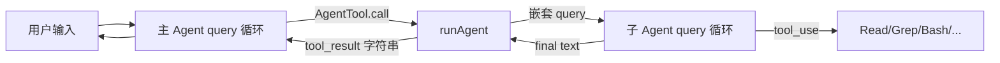
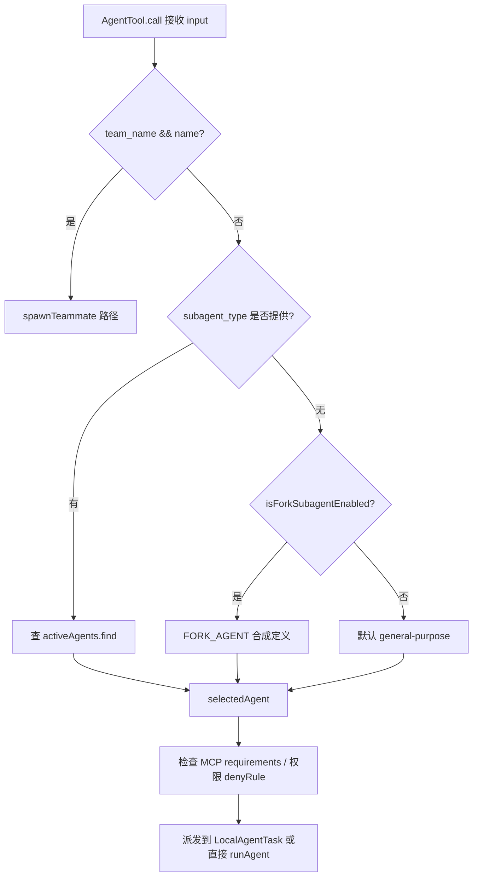
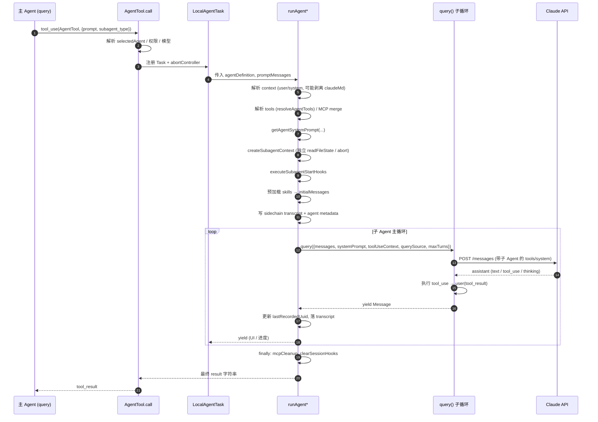
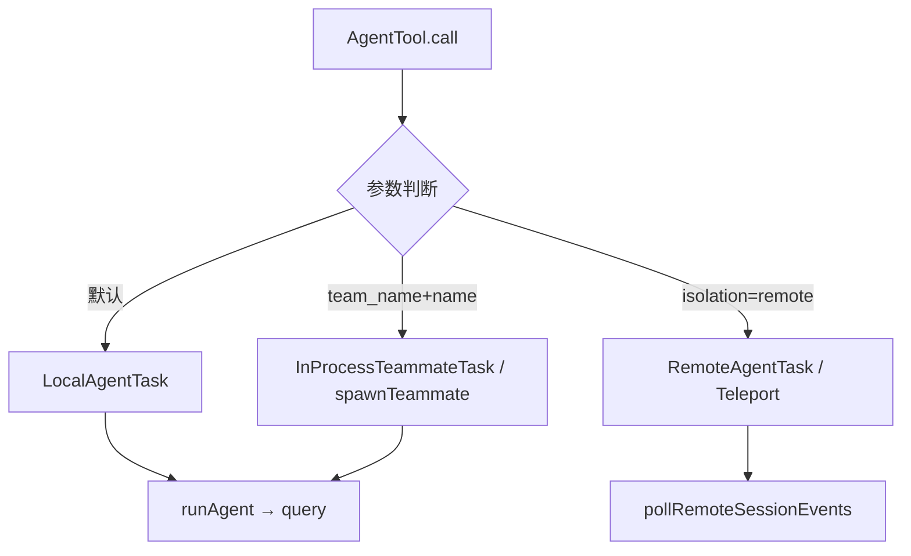
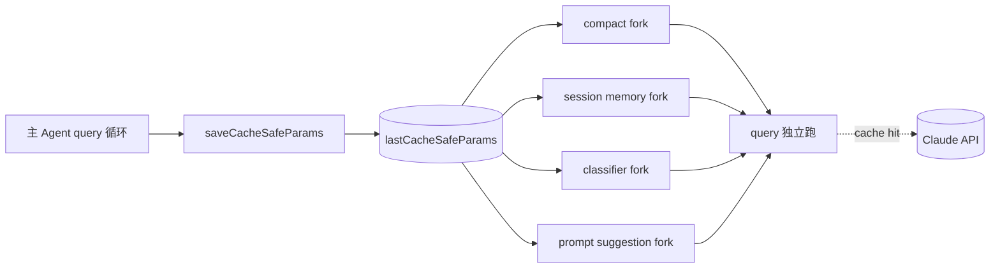

# 05 Subagent 与 AgentTool 系统

> 本文梳理 Claude Code 中的 **子 Agent（Subagent）** 机制：从 `AgentTool` 工具入口，到 `runAgent` 嵌套调用 `query()` 的核心执行链路，再到四类任务封装（Local/InProcessTeammate/Remote）与 `forkedAgent` 辅助工人（compact、session memory、classifier 等）。

---

## 1. 概述：Subagent 是什么？为什么要嵌套 `query()`

主 Agent（main loop）运行在一个 `query()` 生成器里，负责与用户直接对话、调用工具、管理完整上下文。当遇到**可并行的子任务**（大范围代码搜索、计划生成、独立验证等）时，主 Agent 会调用 `AgentTool` 工具把子任务"派发"出去——这就创建了一个 **subagent**。

Subagent 的本质是：**在同一个进程里，用一套隔离的 context、tools、systemPrompt 重新跑一次 `query()`**。

为什么要这样嵌套？

- **上下文隔离**：子任务的中间思考、tool 调用、大段文件内容都留在子 Agent 自己的 messages 里，不会污染主 Agent 的有限上下文窗口。只有最终 `result` 字符串会回到主 Agent。
- **独立工具集**：子 Agent 可以只持有白名单工具（例如 Explore 只读），降低风险。
- **独立模型/effort**：可以给 Plan 用 opus-high，给 Explore 用 haiku-low，主 Agent 仍用 sonnet。
- **并行化**：`run_in_background: true` 让子 Agent 异步跑，主 Agent 继续响应用户。
- **可重入嵌套**：子 Agent 自己也能带 `AgentTool`，再派生孙 Agent（受 `queryTracking.depth` 和 fork 递归守卫限制）。



---

## 2. Agent 类型：Built-in / User / Plugin / Teammate

`loadAgentsDir.ts:162` 定义了 `AgentDefinition` 的联合类型，通过 `source` 字段区分来源：

| 类别 | source | 来源/目录 | 说明 |
|---|---|---|---|
| Built-in | `'built-in'` | `builtInAgents.ts` 硬编码 | general-purpose / Explore / Plan / Statusline Setup / Claude Code Guide / Verification |
| User | `'userSettings'` | `~/.claude/agents/*.md` | 用户全局 agents |
| Project | `'projectSettings'` | `<repo>/.claude/agents/*.md` | 项目级 agents |
| Policy/Managed | `'policySettings'` | 管理员下发 | 企业/策略目录 |
| Flag | `'flagSettings'` | `--settings` CLI 参数 | 临时注入 |
| Plugin | `'plugin'` | 插件包内 | 通过 `loadPluginAgents` 加载 |

参考：
- Built-in 清单：`builtInAgents.ts:45-72`
- 类型定义：`loadAgentsDir.ts:136-166`
- 优先级合并（built-in < plugin < user < project < flag < policy）：`loadAgentsDir.ts:193-221`

Agent 定义的 frontmatter 字段（`loadAgentsDir.ts:106-133`）包括：
`tools`, `disallowedTools`, `skills`, `mcpServers`, `hooks`, `model`, `effort`, `permissionMode`, `maxTurns`, `memory`, `background`, `initialPrompt`, `isolation`, `omitClaudeMd` 等。

**特殊合成 Agent**：
- `FORK_AGENT`（`forkSubagent.ts:60-71`）：合成类型 `'fork'`，不注册到 built-in 列表。当 `subagent_type` 省略且 `FORK_SUBAGENT` 实验开启时触发，继承父级完整对话上下文与 system prompt，`tools: ['*']`、`model: 'inherit'`。

**Teammate**：通过 `team_name + name` 参数进入 `spawnTeammate` 路径（`AgentTool.tsx:284-316`），属于"多 agent 协作"模型，落到 `InProcessTeammateTask` 或 tmux 分屏。

---

## 3. AgentTool 定义：输入 schema 与 `subagent_type`

`AgentTool.tsx:196` 用 `buildTool` 注册工具，核心字段：

```ts
// AgentTool.tsx:82-102
description: '...简短描述 (3-5 词)'
prompt:      '任务的完整 prompt'
subagent_type: '要用哪类 agent'   // optional，下方路由
model:         'sonnet' | 'opus' | 'haiku'  // 可覆盖
run_in_background: boolean
// swarm/teammate 相关
name, team_name, mode
// 隔离执行
isolation: 'worktree' | 'remote'
cwd
```

**`subagent_type` 路由逻辑**（`AgentTool.tsx:318-356`）：



Fork 路径还有**递归守卫**（`AgentTool.tsx:332`）：通过 `querySource === 'agent:builtin:fork'` 或扫描历史 `FORK_BOILERPLATE_TAG` 阻止 fork worker 再次 fork。

---

## 4. `runAgent` 执行流程

`runAgent.ts:248` 是一个 `AsyncGenerator<Message>`，把子 Agent 的消息流 yield 出去。核心入参：`agentDefinition`、`promptMessages`、`toolUseContext`、`forkContextMessages`、`querySource`、`availableTools` 等。

### 时序图



`runAgent.ts` 关键行参考：
- 入口签名与参数：`runAgent.ts:248-329`
- 合并 forkContextMessages + promptMessages → initialMessages：`runAgent.ts:368-378`
- 对只读 agent 剥离 claudeMd / gitStatus（省 token）：`runAgent.ts:386-410`
- 权限模式覆盖与 allowedTools：`runAgent.ts:412-479`
- 构造 `resolvedTools` / MCP 合并：`runAgent.ts:500-664`
- 构造 `agentOptions` / `createSubagentContext`：`runAgent.ts:666-714`
- **核心的嵌套 `query()` 调用**：`runAgent.ts:748`

```ts
// runAgent.ts:748
for await (const message of query({
  messages: initialMessages,
  systemPrompt: agentSystemPrompt,
  userContext: resolvedUserContext,
  systemContext: resolvedSystemContext,
  canUseTool,
  toolUseContext: agentToolUseContext,
  querySource,
  maxTurns: maxTurns ?? agentDefinition.maxTurns,
})) {
  // 过滤 stream_event / 记录 transcript / yield
}
```

注意 `query()` 是 **同一个主循环函数**（`src/query.ts`），子 Agent 与主 Agent 共享实现，只是跑在不同的 `toolUseContext` 和 messages 上。

---

## 5. 任务类型：LocalAgent / InProcessTeammate / RemoteAgent

`src/tasks/` 下定义了若干 TaskState 封装，用于在 UI 的 Task Panel 里管理子 Agent 生命周期：

| 任务类型 | 文件 | 作用 |
|---|---|---|
| **LocalAgentTask** | `tasks/LocalAgentTask/LocalAgentTask.tsx` | 同进程的常规 subagent。跟踪 `ProgressTracker`（tool 使用次数 / token / 最近活动），提供 kill / 结果回传。`run_in_background=true` 或 `background: true` 时走异步路径。 |
| **InProcessTeammateTask** | `tasks/InProcessTeammateTask/InProcessTeammateTask.tsx` | 同进程但使用 **teammate** 语义的子 Agent（受 `team_name`+`name` 参数触发）。拥有可见 transcript，`preserveToolUseResults: true`。无法再派生后台 agent（`AgentTool.tsx:278`）。 |
| **RemoteAgentTask** | `tasks/RemoteAgentTask/RemoteAgentTask.tsx` | **跨进程** 的远程 agent（Teleport / CCR 远端 session），通过 `pollRemoteSessionEvents` 轮询远端 SDK 事件。支持 ultraplan / ultrareview / autofix-pr 等 `remoteTaskType`。 |

三类任务都调用 `registerTask` 进入统一的 Task framework，再通过 `updateTaskState` 驱动 UI 状态。主 Agent 收到 `<task-notification>` XML 提醒任务完成。



---

## 6. Fork Agents：`forkedAgent.ts` 辅助工人

除了用户可见的 subagent，Claude Code 还有一类 **内部 fork agent**，用于后台任务（compact 摘要、session memory 抽取、transcript 分类器、prompt suggestion 等）。它们由 `utils/forkedAgent.ts` 的 `runForkedAgent` 统一调度。

与 `runAgent` 的关键区别：

| 维度 | runAgent (subagent) | runForkedAgent (fork) |
|---|---|---|
| 触发 | LLM 主动调用 AgentTool | 主循环内部逻辑（handleStopHooks、compact 阈值等） |
| 目的 | 执行用户任务 | 压缩 / 抽取 / 推测 |
| Context | 独立 systemPrompt/tools | **与父共享 CacheSafeParams**（system prompt / tools / model / context messages）→ 命中 prompt cache |
| 输出 | 作为 tool_result 回到父 | 作为分析数据写入 state |
| 透明度 | 用户可见为 side-chain transcript | 用户通常不感知 |

`forkedAgent.ts` 的核心抽象是 `CacheSafeParams`（`forkedAgent.ts:57-68`）：

```ts
type CacheSafeParams = {
  systemPrompt: SystemPrompt
  userContext:  { [k: string]: string }
  systemContext:{ [k: string]: string }
  toolUseContext: ToolUseContext  // 带 tools/model/thinkingConfig
  forkContextMessages: Message[]  // 父对话消息前缀
}
```

父 Agent 在 `handleStopHooks` 后通过 `saveCacheSafeParams()`（`forkedAgent.ts:75-81`）保存最新一组。fork 调用方（compact、sessionMemory、promptSuggestion、autoDream、extractMemories、sideQuestion、agentSummary、speculation）读取它作为起点，然后调用 `runForkedAgent(...)`，内部（`forkedAgent.ts:489-626`）会：

1. 用 `createSubagentContext(parent, overrides)` 产生**隔离的** toolUseContext（cloned readFileState / contentReplacementState / abortController），防止污染主循环。
2. 用完全相同的 `systemPrompt + tools + messages` 调 `query()`（`forkedAgent.ts:545`）——因为前缀字节一致，所有输入都是 prompt cache hit。
3. 从 `stream_event` 的 `message_delta.usage` 累积真实 usage。
4. 结束后 `logEvent('tengu_fork_agent_query', ...)` 记录 `forkLabel` / `chainId` / `depth` / `cacheHitRate`。

典型 `forkLabel` 来自（`grep` 结果）：
- `session_memory`（`services/SessionMemory/`）
- `compact`（`services/compact/compact.ts`）
- `classifier` / `transcript_classifier`
- `agent_summary`（`services/AgentSummary/`）
- `prompt_suggestion` / `speculation`
- `auto_dream` / `extract_memories`
- `side_question`



> 这个机制是 Claude Code 榨取 prompt cache 的关键：同一轮对话的上下文**只被 API 预热一次**，后续 compact/summary/classifier 都免费复用，省下大量 tokens。

---

## 7. Query Chain 追踪：`chainId` + `depth`

因为 subagent 会嵌套调用 `query()`，需要一种方式把跨层的 API 调用串起来用于分析和排障。这就是 `toolUseContext.queryTracking`：

```ts
// query.ts:347-355
const queryTracking = toolUseContext.queryTracking
  ? {
      chainId: toolUseContext.queryTracking.chainId,
      depth:   toolUseContext.queryTracking.depth + 1,
    }
  : {
      chainId: deps.uuid(),  // 根查询生成新 chainId
      depth:   0,
    }
```

- **chainId**：整条调用链共享一个 UUID。主 Agent 是 root（`depth=0`），每进入一层嵌套 `query()`（subagent 或 fork）就 `depth+1`。
- 几乎所有分析事件（`tengu_api_query`、`tengu_fork_agent_query` 等）都会带 `queryChainId` + `queryDepth`，参见 `query.ts:501/693/722/940/966/1352/1370/1376/1531/1544/1656/1675` 等埋点。
- 这让后端能重建"主 Agent → LocalAgent → ForkAgent"的完整树。

---

## 8. 子 Agent 的独立工具集 / 上下文 / 模型

这是 subagent 相比 plain chat completion 的核心收益，全部在 `runAgent.ts` 的准备阶段完成：

**独立工具集**（`runAgent.ts:500-664`）：
- `resolveAgentTools(agentDefinition, availableTools, isAsync)` 按 frontmatter 的 `tools` / `disallowedTools` 过滤父级的 `availableTools`。
- Fork 路径 `useExactTools=true`：原样继承父工具池，保证字节一致以命中 cache。
- 额外合并 `agentMcpTools`（agent 自己声明的 MCP servers，`initializeAgentMcpServers`）。

**独立上下文**：
- `forkContextMessages` 可选注入父对话前缀（fork agent 用此实现"继承全部历史"）。
- `createSubagentContext`（`utils/forkedAgent.ts`）克隆 `readFileState`、`contentReplacementState`，保证子 agent 的 Read/Write 不污染父的文件缓存。
- 只读 agents（Explore / Plan）额外剥离 `claudeMd`（省 5-15 Gtok/周）与 `gitStatus`（`runAgent.ts:386-410`）。

**独立模型与权限**：
- `getAgentModel(agentDefinition.model, parentMainModel, explicitOverride, permissionMode)` 解析三级优先级（显式 > frontmatter > inherit）。
- `permissionMode` override（`runAgent.ts:412-451`）：agent 可声明 `bubble` / `acceptEdits` 等；异步 agent 自动开启 `shouldAvoidPermissionPrompts`（没有 UI 可弹）。
- `allowedTools` 会**完全替换** session 级 allow rules（防止父的授权泄漏到子）。

**独立生命周期**：
- async 路径用 **unlinked** AbortController（`runAgent.ts:524-528`），父中止不会连带杀子后台任务；sync 路径共享。
- 独立 `SubagentStart` hooks 注入、独立 `frontmatterHooks` 注册并绑定 agentId 作用域，finally 里 `clearSessionHooks`。
- Transcript 写入 `subagents/<maybe subdir>/<agentId>.jsonl`，通过 `recordSidechainTranscript` 维护 `lastRecordedUuid` 的 O(1) 链式追加。

---

## 9. 相关文件索引

**AgentTool 入口与路由**
- `/Users/huanglin12/myspace/claude-code-source/src/tools/AgentTool/AgentTool.tsx` — 工具定义、输入 schema、`call()` 路由（teammate / fork / 普通 subagent / isolation）
- `/Users/huanglin12/myspace/claude-code-source/src/tools/AgentTool/prompt.ts` — 工具 description 与 agent 列表拼装
- `/Users/huanglin12/myspace/claude-code-source/src/tools/AgentTool/agentToolUtils.ts` — `resolveAgentTools`、结果 schema
- `/Users/huanglin12/myspace/claude-code-source/src/tools/AgentTool/UI.tsx` — 工具调用的 UI 渲染

**Agent 定义加载**
- `/Users/huanglin12/myspace/claude-code-source/src/tools/AgentTool/loadAgentsDir.ts` — 类型系统、frontmatter 解析、多源合并
- `/Users/huanglin12/myspace/claude-code-source/src/tools/AgentTool/builtInAgents.ts` — built-in 列表装配（含 feature flag）
- `/Users/huanglin12/myspace/claude-code-source/src/tools/AgentTool/built-in/*.ts` — 各个 built-in agent 的 prompt 与 tools 配置（generalPurpose / explore / plan / claudeCodeGuide / verification / statuslineSetup）

**执行引擎**
- `/Users/huanglin12/myspace/claude-code-source/src/tools/AgentTool/runAgent.ts` — `runAgent` 生成器，嵌套 `query()` 的核心位置（:748）
- `/Users/huanglin12/myspace/claude-code-source/src/tools/AgentTool/resumeAgent.ts` — 从 sidechain transcript 恢复 agent
- `/Users/huanglin12/myspace/claude-code-source/src/tools/AgentTool/forkSubagent.ts` — `FORK_AGENT` 合成定义与 fork 消息构造（含 cache-identical 占位 tool_result）
- `/Users/huanglin12/myspace/claude-code-source/src/tools/AgentTool/agentMemory.ts` / `agentMemorySnapshot.ts` — agent 持久化 memory

**任务封装**
- `/Users/huanglin12/myspace/claude-code-source/src/tasks/LocalAgentTask/LocalAgentTask.tsx` — 本地 subagent Task
- `/Users/huanglin12/myspace/claude-code-source/src/tasks/InProcessTeammateTask/InProcessTeammateTask.tsx` — 同进程 teammate Task
- `/Users/huanglin12/myspace/claude-code-source/src/tasks/RemoteAgentTask/RemoteAgentTask.tsx` — 远程 agent Task（Teleport / ultraplan / autofix-pr）

**Fork 辅助**
- `/Users/huanglin12/myspace/claude-code-source/src/utils/forkedAgent.ts` — `CacheSafeParams`、`runForkedAgent`、`createSubagentContext`、`logForkAgentQueryEvent`（核心 `query()` 调用在 :545）
- `/Users/huanglin12/myspace/claude-code-source/src/services/compact/compact.ts` — compact fork 消费方
- `/Users/huanglin12/myspace/claude-code-source/src/services/SessionMemory/sessionMemory.ts` — session memory fork 消费方
- `/Users/huanglin12/myspace/claude-code-source/src/services/AgentSummary/agentSummary.ts` — 背景摘要 fork
- `/Users/huanglin12/myspace/claude-code-source/src/services/PromptSuggestion/promptSuggestion.ts` — 提示推测 fork
- `/Users/huanglin12/myspace/claude-code-source/src/utils/sideQuestion.ts` — side question fork

**主循环（参照对比）**
- `/Users/huanglin12/myspace/claude-code-source/src/query.ts` — 所有 subagent/fork 都复用的 `query()` 生成器；`queryTracking.chainId`/`depth` 在 :347 定义

---

## 小结

Subagent 体系是 Claude Code 把"LLM 的单轮对话循环"扩展成**可组合、可并行、可隔离**计算单元的关键抽象：

1. **AgentTool** 是唯一对 LLM 可见的入口，schema 只暴露 `prompt + subagent_type + model + run_in_background`。
2. **runAgent** 负责把一个声明式的 `AgentDefinition` 实例化为一次真实的 `query()` 调用，注入独立 tools / system / context / permission。
3. **三类 Task 封装** 让子 Agent 在 UI / 生命周期层面有统一的注册、进度、kill、通知。
4. **forkedAgent** 则是"对内"的复用路径，借用父 Agent 的 prompt cache 做 compact / memory / classifier 等 side job。
5. **chainId + depth** 贯穿所有层级，让嵌套调用在分析埋点上仍是一棵可重建的树。

理解了这五层，就能把后续任何涉及子 Agent 的特性（plan mode、coordinator、agent swarms、remote agents、workflows）放到正确的位置上看。
