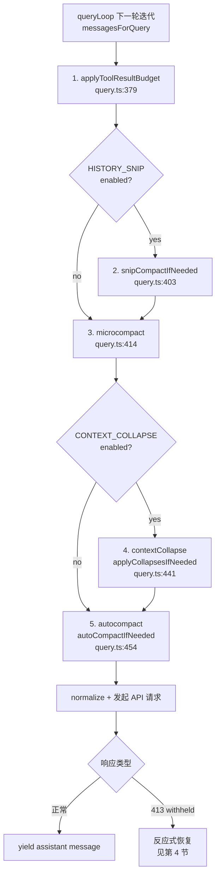
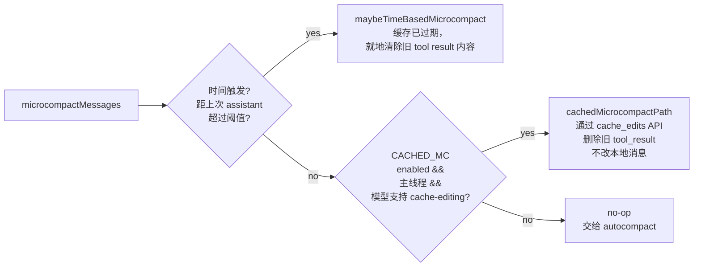
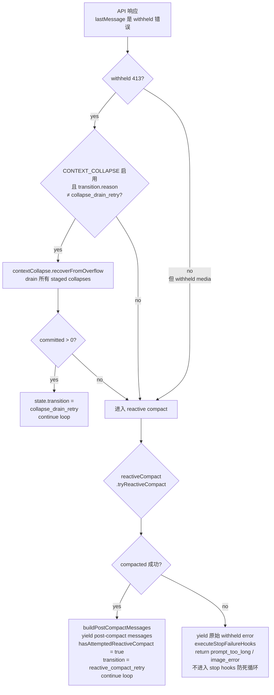

# 06 上下文压缩流水线 (Context Compaction Pipeline)

> 对应源码：`src/query.ts` queryLoop（约 370–470 行：主动压缩流水线；1060–1200 行：反应式 413 恢复）
> 相关模块：`src/services/compact/`、`src/services/contextCollapse/`（内部构建，feature('CONTEXT_COLLAPSE')）、`src/utils/collapse*.ts`、`src/utils/toolResultStorage.ts`

---

## 1. 概述

Claude Code 的对话历史随 turn 增长会很快逼近模型上下文窗口上限。单一的"等满了再总结"策略有两个严重缺陷：

1. **粒度太粗**：一旦触发 autocompact，整段历史被一句总结替代，丢失所有 tool_use/tool_result 细节，后续 turn 想回看原始读取内容就不可能。
2. **容错性差**：依赖 client 端的 token 估算，估算误差或缓存前缀失效时仍可能收到 `prompt_too_long` (413)。

为此 `query.ts` 在每次 API 调用之前按 **从便宜到昂贵、从无损到有损** 的顺序串联 5 级压缩机制，再辅以 **反应式 413 恢复** 兜底。核心直觉：**能在本地解决的就绝不进模型，能只删旧内容的就绝不做 LLM 总结，能保留结构的就绝不整段塌缩**。

### 5 种机制对比

| # | 机制 | 触发条件 | 是否调 LLM | 破坏性 | 缓存友好度 | 可逆性 |
|---|------|----------|-----------|--------|-------------|--------|
| 1 | `applyToolResultBudget` | 单条消息中 tool_result 超 per-message 预算 | 否 | 替换为占位符 + 磁盘落盘 | 高（冻结决策，重放稳定） | 是，原文落盘可回读 |
| 2 | `snipCompactIfNeeded` | feature('HISTORY_SNIP')，启发式条件 | 否 | 就地截断/标记 snipped | 中 | 部分（snipped 消息仍在数组中） |
| 3 | `microcompact` | 时间阈值或 CACHED_MC 工具计数阈值 | 否（cached MC 用 cache_edits API）| 清除旧工具结果内容 | **非常高**（用 cache_edits 编辑已缓存前缀，不重写） | 否 |
| 4 | `contextCollapse` | 同类消息连续出现 | 否（投影层面），局部可调 LLM | 折叠为 summary 视图 | 高（REPL 全量历史不变） | 是（投影可重放） |
| 5 | `autoCompactIfNeeded` | token 接近窗口上限 | **是**（整段总结） | 整段替换为 summary + compact_boundary | 低（cache break） | 否（原文只保留在 transcript 中） |
| * | `reactiveCompact` | API 返回 `prompt_too_long` (413) | 是 | 同 autocompact + 可能 strip 媒体 | 低 | 否 |

---

## 2. 5 级流水线总览



关键顺序设计动机（`query.ts:428-439` 注释）：

- **toolResultBudget 最先**：它是按 tool_use_id 去重的"幂等替换"，不改变消息结构，后续阶段看不到差别。
- **snip 在 microcompact 之前**：两者不互斥，但 snip 释放的 token 数 (`snipTokensFreed`) 必须传给 autocompact，否则后者的阈值检查看不到 snip 的效果（因为它基于受保护尾部 assistant 消息的 usage 字段）。
- **microcompact 在 collapse 之前**：microcompact 按 tool_use_id 操作，对消息内容无感，先后顺序无所谓；但放在 collapse 前可以让 cached MC 的 pending cache edits 尽早准备好。
- **collapse 在 autocompact 之前**：如果折叠能把 token 压到阈值之下，autocompact 就会 no-op，从而保留更细的粒度，而不是直接变成一句话 summary。
- **autocompact 最后**：最贵、最有损，是最后防线。

---

## 3. 每级详解

### 3.1 applyToolResultBudget — 工具结果预算裁剪

**位置**：`src/utils/toolResultStorage.ts:924`，在 `query.ts:379` 调用。

**核心思想**：每条 user 消息里的 tool_result 加起来不能超过 per-message 预算 (`getPerMessageBudgetLimit()`)。超标的 tool_result 被替换成占位符字符串，原内容写入磁盘 transcript，后续 resume 时通过 `reconstructContentReplacementState` 重放决策，保证 prompt cache 稳定。

**关键机制**（`toolResultStorage.ts:780-910`）：

- **partitionByPriorDecision**：把 candidates 分成 `mustReapply`（历史已替换，必须沿用）、`frozen`（历史见过但未替换，冻结为原状）、`fresh`（首次出现，可选择替换）。
- **selectFreshToReplace**：只对 fresh 部分做预算选择，保证决策的幂等性 —— 同一个 tool_use_id 在整个会话里要么永远是原文，要么永远是占位符，绝不翻转，否则会破坏 prompt cache。
- **skipToolNames**：带 `maxResultSizeChars: Infinity` 的工具（例如 Read）永不被裁，它自己的 maxTokens 才是上界。
- **persist 回调**：只有 `repl_main_thread*` / `agent:*` 这些会在 resume 时回读 transcript 的 querySource 才调 `recordContentReplacement` 写盘，一次性的 forked agent（agentSummary、sessionMemory、/btw、compact）不写。

**性质**：无 LLM、无网络、纯本地 I/O。对 prompt cache 几乎 0 影响（替换结果稳定）。

### 3.2 snipCompact — 启发式截断

**位置**：`src/services/snip/`（ant-only，feature('HISTORY_SNIP')），通过动态 require 加载到 `query.ts:115` 的 `snipModule`。

**调用点**：`query.ts:403`

```ts
const snipResult = snipModule!.snipCompactIfNeeded(messagesForQuery)
messagesForQuery = snipResult.messages
snipTokensFreed = snipResult.tokensFreed
if (snipResult.boundaryMessage) {
  yield snipResult.boundaryMessage  // 会插入一个可见的 boundary 系统消息
}
```

**核心思想**：用启发式规则（不是 LLM）识别可以安全"掐头"的中段历史（例如已被后续操作覆盖的 tool_result、已提交的 git 操作残留、旧的 bash 输出），并就地标记为 snipped。相关的工具：`tools/SnipTool`（用户可显式调用）。被 snip 的消息仍在数组中，渲染时会被 `includeSnipped: false` 过滤掉 (`utils/messages.ts:4635-4648`)。

**关键 plumbing**：`snipTokensFreed` 一路透传到 `autoCompactIfNeeded`，因为 autocompact 的阈值检查直接读最后一条 assistant 消息的 `usage.input_tokens`，看不到 snip 的效果，必须显式告诉它"其实已经少了这么多"，否则会出现 snip 之后 autocompact 仍然误触发的问题。

### 3.3 microcompact — 微压缩

**位置**：`src/services/compact/microCompact.ts:253` (`microcompactMessages`)，`src/services/compact/apiMicrocompact.ts`（API 层 cache_edits 实现），`src/services/compact/timeBasedMCConfig.ts`。

调用入口在 `query.ts:414`：`deps.microcompact(messagesForQuery, toolUseContext, querySource)`。

**两条路径**：



#### 3.3.1 Time-based MC

当距离上一条 assistant 消息的时间差超过阈值（`timeBasedMCConfig.ts`），服务端的 prompt cache 实际上已经冷却了，下一次请求无论如何都会重写整个前缀。**既然前缀要重写，那就先把老的大 tool_result 内容替换成 `[Old tool result content cleared]`，让重写变短。**

#### 3.3.2 Cached MC（ant-only）

**革命性点**：普通 microcompact 必须修改本地消息内容，这会让下一次请求的 prompt prefix 变化 → 缓存 miss → 重写全部。而 Cached MC 通过 Anthropic 的 **cache editing API** 直接在已缓存的前缀上打"删除指定 tool_result"的补丁，本地消息结构、内容完全不动，缓存继续命中。

- 在 `messages` 数组 **不变** 的前提下，把要删的 `tool_use_id` 收集到 `pendingCacheEdits: CacheEditsBlock`。
- 由 API 层（`apiMicrocompact.ts`）在真正发请求时把 `cache_reference` + `cache_edits` 拼进 request body。
- 服务端返回真实的 `cache_deleted_input_tokens`，`query.ts:420-425` 推迟 boundary 消息的生成直到拿到该数值，再 yield 一个 `microcompact_boundary`。
- 只对**主线程** (`isMainThreadSource(querySource)`) 启用：否则 forked agent 会把自己的 tool_use_id 注册进全局 `cachedMCState`，污染主线程。

**结果**：`MicrocompactResult.compactionInfo.pendingCacheEdits` 被 `query.ts:423-425` 捕获，延后 yield boundary。

### 3.4 contextCollapse — 同类消息折叠

**位置**：`src/services/contextCollapse/`（ant-only，feature('CONTEXT_COLLAPSE')，通过动态 require 加载于 `query.ts:18-20`），工具函数在 `src/utils/collapse*.ts`。

调用点 `query.ts:441`：

```ts
const collapseResult = await contextCollapse.applyCollapsesIfNeeded(
  messagesForQuery, toolUseContext, querySource,
)
messagesForQuery = collapseResult.messages
```

**核心思想**：连续出现的同类消息（一串 Read、一串 Grep、一串 PostToolUse hook summary、多个 teammate shutdown 通知、多个 background bash notification）合并成一个"占位符 + 计数/摘要"。

#### 折叠器家族

| 折叠器 | 文件 | 目标 |
|--------|------|------|
| Read/Search | `utils/collapseReadSearch.ts` | 连续的 Read/Grep/Glob/WebSearch/WebFetch/ToolSearch/Snip 合并为 `CollapsedReadSearchGroup` |
| Hook summaries | `utils/collapseHookSummaries.ts` | 相同 `hookLabel` 的连续 `stop_hook_summary` 合并（并行工具调用时每个 tool 都会 emit 一个） |
| Teammate shutdowns | `utils/collapseTeammateShutdowns.ts` | 多个 teammate 的"下线"系统消息合并 |
| Background bash notifications | `utils/collapseBackgroundBashNotifications.ts` | 后台 bash 的多条 notification 合并 |

#### "投影层"架构

注释 `query.ts:428-439` 强调了一个关键设计：

> Nothing is yielded — the collapsed view is a read-time projection over the REPL's full history. Summary messages live in the collapse store, not the REPL array. This is what makes collapses persist across turns: `projectView()` replays the commit log on every entry.

也就是说：
- REPL 数组里始终保留**全量原始消息**。
- `contextCollapse` 维护一个独立的 **commit log**（staged/committed collapses）。
- 每次进入 queryLoop，`projectView()` 把 commit log 重放到原始消息上，产出一个"压缩视图" `messagesForQuery`。
- 下一轮 `projectView()` 是幂等的，因为被折叠的消息已经不在它的输入里。
- Turn 内的继续点 (`query.ts:1192`) 通过 `state.messages` 把折叠视图向前传递。

**好处**：用户执行 `/context` 等命令时可以看到 **真实的** 全量历史（或折叠视图由用户选择）；折叠可以被 **回滚**（reactive 413 恢复的 `recoverFromOverflow` 就是 drain staged collapses）。

### 3.5 autocompact — 全量压缩

**位置**：`src/services/compact/autoCompact.ts:241` (`autoCompactIfNeeded`)、`src/services/compact/compact.ts` (`compactConversation`)。

调用点 `query.ts:454`：

```ts
const { compactionResult, consecutiveFailures } = await deps.autocompact(
  messagesForQuery, toolUseContext,
  { systemPrompt, userContext, systemContext, toolUseContext,
    forkContextMessages: messagesForQuery },
  querySource, tracking, snipTokensFreed,
)
```

**触发条件**：`shouldAutoCompact(messages, model, querySource, snipTokensFreed)`，当前 token 使用量 > `getAutoCompactThreshold(model)`（= `contextWindow - MAX_OUTPUT_TOKENS_FOR_SUMMARY (20k) - AUTOCOMPACT_BUFFER_TOKENS (13k)`）。

**三个分支**（`autoCompact.ts:241-351`）：

1. **环境变量 `DISABLE_COMPACT`** → no-op。
2. **熔断器**：`consecutiveFailures >= MAX_CONSECUTIVE_AUTOCOMPACT_FAILURES (3)` → no-op。注释提到上线后发现 1279 个 session 有 50+ 连续失败（最多 3272 次），浪费 ~250K API calls/day。
3. **Session Memory Compaction (实验)** → 若启用，优先尝试 `trySessionMemoryCompaction`，成功直接返回。
4. **Legacy path** → `compactConversation(...)` 调模型做总结，生成：
   - 一条 `SystemCompactBoundaryMessage`（`createCompactBoundaryMessage`，`compact.ts:598`），记录 `preCompactTokenCount`、`isAutoCompact`、`preCompactDiscoveredTools` 等。
   - 一条 `UserMessage`，内容为总结文本，`isCompactSummary: true`。
   - 执行 `processSessionStartHooks('compact')` —— 因为从模型视角这是一次"新会话"开始。

**post-cleanup**：`runPostCompactCleanup(querySource)`，`setLastSummarizedMessageId(undefined)`，`notifyCompaction(...)` 重置 prompt cache break 检测基线，`markPostCompaction()` 打标签。

**失败处理**：抛异常则 `consecutiveFailures++`，返回 `{ wasCompacted: false, consecutiveFailures: nextFailures }`，通过 tracking 状态带进下一轮。

---

## 4. 反应式压缩 / 413 恢复

即使前面 5 级全部跑过，仍有可能因为：
- 客户端 token 估算偏差
- 服务端 cache prefix 不可用 → 整段 re-send 超限
- 某条 tool_result 里塞了一张巨大图片

导致 API 返回 `prompt_too_long` 或 media size error。此时 streaming 层**扣留** (`withhold`) 错误消息而不是直接 yield，`query.ts` 末段检测到 last message 是被 withheld 的错误，进入恢复流程。

### 恢复流程



### 关键防护

1. **`hasAttemptedReactiveCompact` 标志** (`query.ts:1104, 1157`)：每次成功反应式压缩后置为 `true`，下一次再次 413 时不会再触发（tryReactiveCompact 内部会看该标志拒绝重试），否则会陷入"压缩 → 超限 → 再压缩 → 再超限"的死循环。

2. **顺序：collapse drain → reactive compact → surface**：
   - 优先 drain staged collapses，因为它便宜、无损、能保留细粒度。
   - `state.transition.reason !== 'collapse_drain_retry'` 保证只做一次 drain：如果已经 drain 过还是 413，说明折叠空间已经耗尽，直接升级到 reactive compact。
   - 反应式压缩就是再走一次 `compactConversation`，但 `cacheSafeParams.forkContextMessages` 用的是 **413 失败那次的输入**，保证拿到最完整上下文再做总结。

3. **media 错误跳过 collapse drain**：collapse 不会 strip 图片，对媒体错误无效，直接进 reactive compact（它的 strip-retry 分支会移除大图）。

4. **错误不走 stop hooks**（`query.ts:1168-1174`）：
   > Do NOT fall through to stop hooks: the model never produced a valid response, so hooks have nothing meaningful to evaluate. Running stop hooks on prompt-too-long creates a death spiral: error → hook blocking → retry → error → … (the hook injects more tokens each cycle).

5. **task_budget 扣减**：反应式压缩成功后，用 pre-compact 的 `finalContextTokensFromLastResponse` 从任务预算里扣除相应的 token 数（`query.ts:1138-1146`），和主动压缩路径保持一致。

---

## 5. compact_boundary 消息与 resume 链

每次（主动或反应式）autocompact 成功都会产出一条 `SystemCompactBoundaryMessage`（`createCompactBoundaryMessage`，`utils/messages.ts`）。它是**历史重建的锚点**，性质类似 git 的 merge commit。

**compact_boundary 携带的关键字段**（`compact.ts:598-611`）：

- `subtype: 'compact_boundary'`
- `compactMetadata.trigger: 'auto' | 'manual'`
- `compactMetadata.preCompactTokenCount`：被压缩掉的 token 总量（用于用户感知成本）
- `compactMetadata.preCompactDiscoveredTools`：压缩前已"发现"（DeferredTool 已 load 到 schema 里）的工具列表 —— 因为 summary 不保留 `tool_reference` 块，post-compact 需要这个列表在下一次 API 请求时继续带上对应的 schema，否则模型突然"失忆"某个工具。
- 最后一条 message 的 `uuid`：作为 boundary 前缀的"终点"。

**resume 时的使用**（`utils/messages.ts` 中的 `getMessagesAfterCompactBoundary` 和 `findLastCompactBoundaryIndex`）：

- `/resume` 加载 transcript 时，沿着消息数组**反向**扫描，找到最后一个 compact_boundary。
- boundary **之前**的所有消息在恢复后仅用于 transcript 展示 (`isVisibleInTranscriptOnly`)，不进入 API 请求。
- boundary **之后**的消息（从 summary user message 开始）作为恢复会话的 working set。
- 如果一个 session 经历多次 recompact，会形成 boundary 链；`findLastCompactBoundaryIndex` 只认最近的那一个（`compact.ts:787` 注释提到的反向扫描）。

**Recompaction 链追踪**：`RecompactionInfo`（`compact.ts` + `autoCompact.ts:279-285`）带 `isRecompactionInChain`, `turnsSincePreviousCompact`, `previousCompactTurnId`，进入分析事件，用于监控"同一 session 反复 recompact"这类异常模式。

---

## 6. 相关文件索引

主流程：
- `src/query.ts:370-470` — 5 级主动流水线主干
- `src/query.ts:1060-1200` — 反应式 413 / media 错误恢复
- `src/query.ts:15-20` — reactiveCompact / contextCollapse 的 feature-gated require
- `src/query.ts:115` — snipModule 的 feature-gated require

每级实现：
- `src/utils/toolResultStorage.ts:780-990` — applyToolResultBudget / enforceToolResultBudget / reconstructContentReplacementState
- `src/services/snip/` (ant-only) — snipCompactIfNeeded / SnipTool
- `src/tools/SnipTool/prompt.ts` — 用户可调用的 Snip 工具
- `src/services/compact/microCompact.ts` — microcompactMessages / timeBased / cachedMicrocompactPath
- `src/services/compact/apiMicrocompact.ts` — cache_edits 在 API 层的拼装
- `src/services/compact/cachedMicrocompact.ts` — CachedMCState / registerToolResult / getToolResultsToDelete
- `src/services/compact/timeBasedMCConfig.ts` — 时间阈值配置
- `src/services/contextCollapse/` (ant-only) — applyCollapsesIfNeeded / recoverFromOverflow / projectView / commit log
- `src/utils/collapseReadSearch.ts` — Read/Search/MCP/REPL 折叠
- `src/utils/collapseHookSummaries.ts` — PostToolUse hook 摘要折叠
- `src/utils/collapseTeammateShutdowns.ts` — teammate 下线消息折叠
- `src/utils/collapseBackgroundBashNotifications.ts` — 后台 bash 通知折叠
- `src/services/compact/autoCompact.ts:241` — autoCompactIfNeeded（主入口）
- `src/services/compact/autoCompact.ts:33-91` — 阈值计算 (getEffectiveContextWindowSize / getAutoCompactThreshold)
- `src/services/compact/compact.ts:580-630` — compactConversation 内部的 boundary/summary 构造
- `src/services/compact/sessionMemoryCompact.ts` — 实验性 session memory 分支
- `src/services/compact/postCompactCleanup.ts` — post-cleanup
- `src/services/compact/reactiveCompact.ts` (ant-only) — tryReactiveCompact / isWithheldPromptTooLong / isWithheldMediaSizeError
- `src/services/compact/compactWarningHook.ts` / `compactWarningState.ts` — 压缩前警告 hook 与抑制状态

Boundary / resume：
- `src/utils/messages.ts` — createCompactBoundaryMessage / getMessagesAfterCompactBoundary / findLastCompactBoundaryIndex / isCompactBoundaryMessage
- `src/utils/messages.ts:4635-4648` — includeSnipped 过滤
- `src/utils/sessionStorage.ts` — transcript 落盘与读取

Feature flags 相关：`HISTORY_SNIP`、`CACHED_MICROCOMPACT`、`CONTEXT_COLLAPSE`、`REACTIVE_COMPACT`、`PROMPT_CACHE_BREAK_DETECTION`、`TEAMMEM`、`SESSION_MEMORY` 等均通过 `bun:bundle` 的 `feature()` 做 dead-code elimination，外部构建不包含对应实现。
