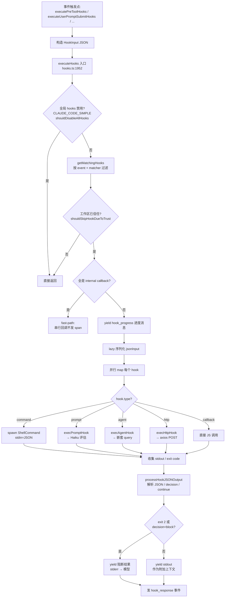
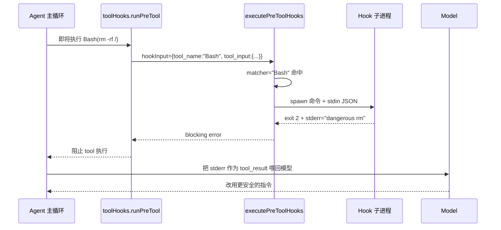
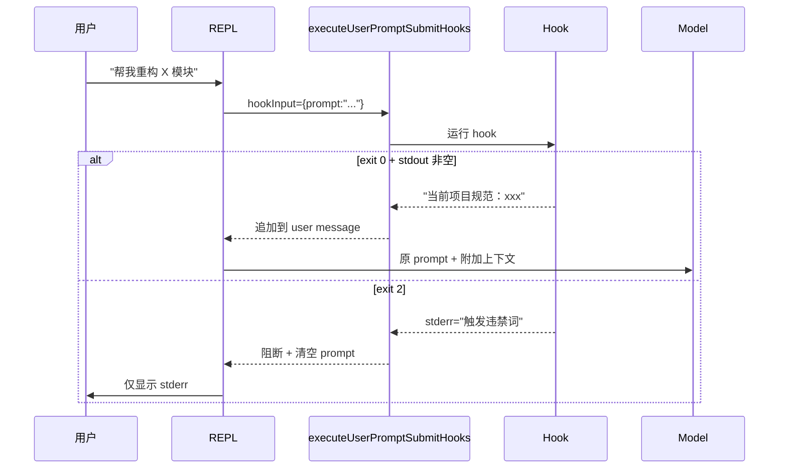
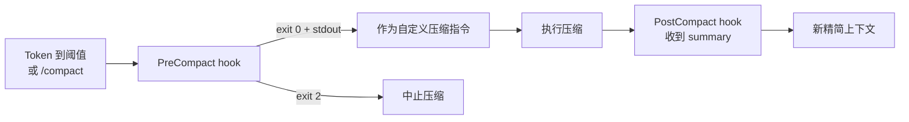
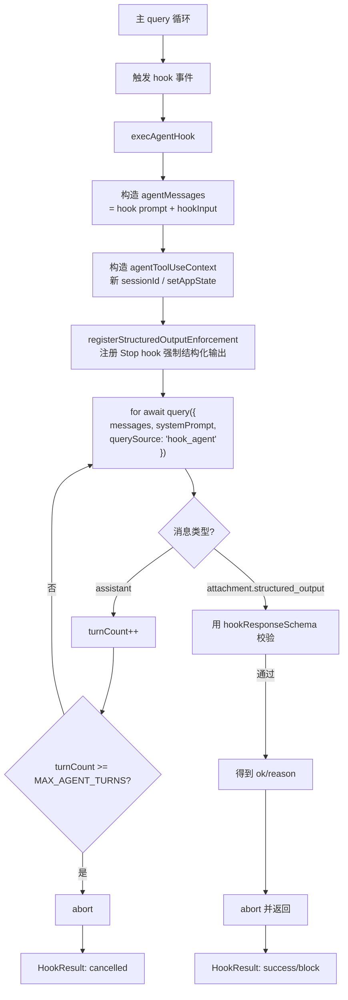
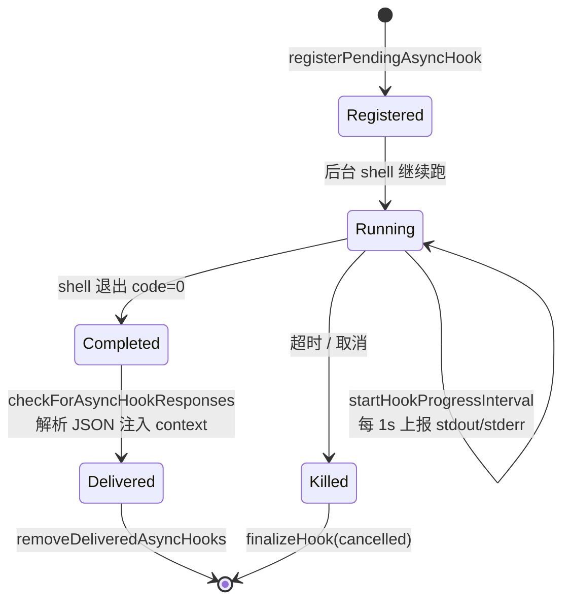

# 07 Hooks 系统

> 注：此处的 Hooks 指 Claude Code 的**用户可配置事件钩子**（PreToolUse / PostToolUse / UserPromptSubmit / Stop / SessionStart / PreCompact 等），**不是** React Hooks。

## 1. 概述

Hooks 系统是 Claude Code 提供给用户的**事件回调扩展点**：用户在 `settings.json` 中为特定事件注册 hook，在 Agent 运行的关键时刻（工具执行前/后、用户 prompt 提交、会话开始/结束、压缩前后……），CLI 会自动触发已注册的 hook，并根据 hook 的退出码 / JSON 输出来：

- **注入额外上下文**（把 stdout 作为 system 信息喂给模型）
- **阻断操作**（exit 2 可以拦截 tool 调用、阻止 prompt 处理）
- **执行副作用命令**（审计日志、格式化代码、环境变量刷新等）
- **包装 LLM 调用**（prompt / agent 类型的 hook 会把上下文送入另一个模型做决策）

Hooks 源码集中在 `src/utils/hooks/` 目录下，核心分发逻辑在 `src/utils/hooks.ts`（4500+ 行的超大模块）。

关键文件：
- `src/utils/hooks/hookEvents.ts` — hook 执行事件广播（started / progress / response）
- `src/utils/hooks/hooksSettings.ts` — 从 settings.json 各层级读取 hooks
- `src/utils/hooks/hooksConfigManager.ts` — 事件元数据（matcher 字段、描述）
- `src/utils/hooks/execPromptHook.ts` — prompt 类型 hook 执行器
- `src/utils/hooks/execAgentHook.ts` — agent 类型 hook 执行器（内嵌 query()）
- `src/utils/hooks/execHttpHook.ts` — HTTP 类型 hook 执行器
- `src/utils/hooks/AsyncHookRegistry.ts` — 异步 hook 注册表
- `src/utils/hooks.ts` — `executeHooks()` 主入口 + 各事件触发函数

## 2. Hook 事件类型清单（27 种）

事件枚举定义在 `src/entrypoints/sdk/coreTypes.ts:25` 与 `coreSchemas.ts:355`，元数据描述见 `hooksConfigManager.ts:26`。

| 事件 | 触发时机 | Matcher 字段 | 典型用途 |
|---|---|---|---|
| `PreToolUse` | 工具执行前 | `tool_name` | 拦截危险命令、注入前置检查（exit 2 阻断） |
| `PostToolUse` | 工具执行成功后 | `tool_name` | 自动格式化、lint、记录日志 |
| `PostToolUseFailure` | 工具执行失败后 | `tool_name` | 错误处理、补偿措施 |
| `PermissionDenied` | 权限分类器拒绝后 | `tool_name` | 提示模型可重试 / 记录 |
| `PermissionRequest` | 权限弹窗时 | `tool_name` | 自动批准/拒绝 |
| `Notification` | 系统通知时 | `notification_type` | 桌面推送、IM 通知 |
| `UserPromptSubmit` | 用户提交 prompt 后 | — | 注入动态上下文、拦截违禁词（exit 2 清空原 prompt） |
| `SessionStart` | 会话启动（startup/resume/clear/compact） | `source` | 加载环境变量、装载项目上下文 |
| `SessionEnd` | 会话结束 | `reason` | 收尾清理 |
| `Stop` | Claude 即将结束本轮回答前 | — | 强制继续（exit 2 喂 stderr 给模型） |
| `StopFailure` | 因 API 错误结束时 | `error` | 错误上报（fire-and-forget） |
| `SubagentStart` | Agent 工具子代理启动时 | `agent_type` | 向子代理注入 context |
| `SubagentStop` | 子代理结束前 | `agent_type` | 验证子代理产出 |
| `PreCompact` | 对话压缩前 | `trigger` (manual/auto) | 追加压缩指令 / 阻止压缩 |
| `PostCompact` | 对话压缩后 | `trigger` | 展示摘要 |
| `Setup` | init / maintenance | `trigger` | 仓库首次设置 |
| `TeammateIdle` | 队友即将空闲 | — | 阻止空闲 |
| `TaskCreated` | 创建任务时 | — | 审核任务 |
| `TaskCompleted` | 完成任务时 | — | 质检 |
| `Elicitation` | MCP 服务请求用户输入 | `mcp_server_name` | 自动应答 |
| `ElicitationResult` | 用户应答 MCP 之后 | `mcp_server_name` | 覆盖应答 |
| `ConfigChange` | 会话中配置文件变化 | `source` | 阻止应用 |
| `InstructionsLoaded` | CLAUDE.md / rule 被加载 | `load_reason` | 可观测性（不可阻断） |
| `WorktreeCreate` | 创建隔离工作树 | — | VCS 无关的隔离 |
| `WorktreeRemove` | 删除工作树 | — | 清理 |
| `CwdChanged` | 工作目录变更后 | — | 写 `CLAUDE_ENV_FILE` 应用到后续 Bash |
| `FileChanged` | 监听文件变化 | 文件名 glob | 监控 `.envrc`、配置重载 |

两个「总是广播」的事件：`SessionStart`、`Setup`（参见 `hookEvents.ts:18`）。其余事件仅在 SDK `includeHookEvents` 或 `CLAUDE_CODE_REMOTE` 模式下向外广播。

## 3. Hook 类型：command / prompt / http / agent / callback

hook 配置的 `type` 字段决定执行方式（见 `hooksSettings.ts:45`）：

| 类型 | 执行方式 | 实现位置 |
|---|---|---|
| `command` | 启动 shell 子进程，stdin 传 JSON，解析 stdout/exit code | `hooks.ts` 中的 shell 分支 |
| `prompt` | 调用小模型（默认 Haiku）评估 JSON 条件，返回 `{ok, reason?}` | `execPromptHook.ts` |
| `agent` | **嵌套 query() 运行一个完整子 Agent**，带 turn 上限 + 结构化输出校验 | `execAgentHook.ts:167` |
| `http` | 向白名单 URL 发 HTTPS POST，带 SSRF 防护和沙箱代理 | `execHttpHook.ts` |
| `callback` / `function` | 进程内 JS 回调（内部使用，如 attributionHooks） | `hooks.ts:2049` |

所有类型都遵循相同的**输出契约**（JSON in stdin → stdout JSON / exit code → HookResult），区别只在执行引擎不同。

## 4. Hook 配置格式（settings.json）

```json
{
  "hooks": {
    "PreToolUse": [
      {
        "matcher": "Bash",
        "hooks": [
          {
            "type": "command",
            "command": "~/.claude/guard-bash.sh",
            "timeout": 10,
            "shell": "bash",
            "if": "Bash(rm *)"
          }
        ]
      }
    ],
    "UserPromptSubmit": [
      {
        "hooks": [
          { "type": "prompt", "prompt": "$ARGUMENTS 是否包含敏感信息？" }
        ]
      }
    ],
    "PostToolUse": [
      {
        "matcher": "Write|Edit",
        "hooks": [
          { "type": "http", "url": "https://audit.example.com/log" }
        ]
      }
    ]
  }
}
```

Hooks 可以来自 6 个来源（`hooksSettings.ts:15`）：
- `userSettings` — `~/.claude/settings.json`
- `projectSettings` — `.claude/settings.json`
- `localSettings` — `.claude/settings.local.json`
- `policySettings` — 管理策略层（可通过 `allowManagedHooksOnly` 锁死只允许此层）
- `pluginHook` — `~/.claude/plugins/*/hooks/hooks.json`
- `sessionHook` — 运行时临时注入（`sessionHooks.ts`）
- `builtinHook` — Claude Code 内部注册

同一事件下的 matcher 按来源优先级排序（见 `hooksSettings.ts:230 sortMatchersByPriority`）。

## 5. Hook 执行引擎总流程

主入口是 `executeHooks()`，定义在 `src/utils/hooks.ts:1952`。



关键机制：

1. **并行执行 + 独立超时**：每个 hook 通过 `createCombinedAbortSignal` 绑定独立超时（默认 `TOOL_HOOK_EXECUTION_TIMEOUT_MS`，可按 hook 覆盖），一个 hook 超时不影响其它。
2. **lazy jsonInput**：同一批次内 `hookInput` 只 stringify 一次（`hooks.ts:2128`）。
3. **internal callback fast-path**：attributionHooks / sessionFileAccessHooks 全部为 callback 时走精简路径，从 ~6µs 降到 ~1.8µs（`hooks.ts:2040`）。
4. **异步 hook**：shell hook 可以返回 `{ async: true, asyncTimeout: ms }` 立即返回，后台继续跑，稍后由 `AsyncHookRegistry` 轮询收取（见第 8 节）。

## 6. 关键事件流程图

### 6.1 PreToolUse（可阻止 tool 执行）

定义在 `hooks.ts:3418` 附近，由 `src/services/tools/toolHooks.ts:466` 在工具执行前调用。



- exit 0：`stdout` 作为附加信息（transcript 模式可见）
- exit 2：**阻断**，`stderr` 注入到 model 上下文
- 其他 exit：`stderr` 仅展示给用户，工具照常执行

### 6.2 UserPromptSubmit（可注入额外 prompt）

触发位置：`hooks.ts:3843`。用户每次提交 prompt 后、真正调用模型前。



### 6.3 PreCompact / PostCompact



`PreCompact` 可以通过 stdout 追加 **「请额外保留 X 相关细节」** 之类的自定义压缩指令。

### 6.4 SessionStart / Stop

- **SessionStart**：`source ∈ {startup, resume, clear, compact}`。stdout 会被当作 system 信息注入，常用于加载项目级 CLAUDE.md 之外的动态环境。hook 跑完后会调用 `invalidateSessionEnvCache()` 刷新环境变量缓存（`AsyncHookRegistry.ts:258`）。
- **Stop**：Claude 准备结束回合时触发，exit 2 可让模型「继续干活」，常用于实现「必须跑完测试才能结束」这类强约束。

## 7. Agent Hook：嵌套的 query() 调用

`execAgentHook.ts` 是最特殊的 hook 类型：它本身就跑一个完整的子 Agent。



关键点（`execAgentHook.ts:167`）：
- 以 `querySource: 'hook_agent'` 调用 `query()` — 和主循环走同一套 Agent 核心，只是语义上作为 hook；
- 有独立的 `MAX_AGENT_TURNS` 上限，防止 hook agent 无限调工具；
- 通过 `registerStructuredOutputEnforcement` 注册了一次性的 Stop hook，强制子 agent 必须产出 `{ok: boolean, reason?: string}` 结构化输出；
- 子 agent 可以读取项目代码、跑测试、查文档，再做出 hook 决策 —— 相当于「让 Claude 来决定要不要拦截这次 tool 调用」。

## 8. AsyncHookRegistry（异步 hook 注册）

某些 hook 需要跑很久（跑完整测试套件、远程审计），不能阻塞主循环。解决方案：shell hook 可以立即输出一行 `{"async": true, "asyncTimeout": 300000}` 然后返回，主循环立刻继续；后台进程继续跑，由 `AsyncHookRegistry` 追踪。

核心 API（`AsyncHookRegistry.ts`）：

| 函数 | 作用 |
|---|---|
| `registerPendingAsyncHook` | 注册待收取的后台 hook，启动进度上报定时器 |
| `getPendingAsyncHooks` | 查询未完成的 hook |
| `checkForAsyncHookResponses` | **主循环每轮调用**：扫描已完成的 hook，解析 stdout 里的 JSON 行作为响应，封装成 attachment 注入下一轮 context |
| `finalizePendingAsyncHooks` | 会话结束时强制收尾，未完成的 kill 掉 |
| `removeDeliveredAsyncHooks` | 清理已投递的 hook |



SessionStart 的 async hook 完成后会触发 `invalidateSessionEnvCache()`（`AsyncHookRegistry.ts:258`），保证后续 Bash 工具能读到新的环境变量。

## 9. 相关文件索引

### 核心目录 `src/utils/hooks/`

- `hookEvents.ts` — hook 执行过程的三类事件广播（started / progress / response）；SDK 对外 stream 的源头
- `hooksSettings.ts:92 getAllHooks` — 从 6 个来源聚合 hook 配置
- `hooksConfigManager.ts:26 getHookEventMetadata` — 27 种事件的 matcher 元数据（memoized）
- `hooksConfigManager.ts:270 groupHooksByEventAndMatcher` — 按 event+matcher 分组，供 UI 与匹配器消费
- `hooksConfigSnapshot.ts` — 配置快照（用于会话期 diff 检测）
- `execPromptHook.ts:21` — 用 Haiku 小模型评估 hook 条件，强制结构化输出
- `execAgentHook.ts:167` — 嵌套 `query()` 运行完整子 Agent 做决策
- `execHttpHook.ts` — HTTPS POST，带 SSRF 防护、沙箱代理、URL/env 白名单
- `hookHelpers.ts` — `addArgumentsToPrompt`（$ARGUMENTS 展开）、`hookResponseSchema`（ok/reason 校验）
- `apiQueryHookHelper.ts` — API 查询 hook 的辅助（请求/响应拦截）
- `postSamplingHooks.ts` — 模型采样后的 hook
- `sessionHooks.ts` — 运行时临时注入的 session hook
- `AsyncHookRegistry.ts` — 异步 hook 追踪（第 8 节）
- `ssrfGuard.ts` — HTTP hook 的 SSRF 防护（DNS 解析守卫）
- `fileChangedWatcher.ts` — `FileChanged` 事件的文件监听实现
- `registerFrontmatterHooks.ts` — 通过 Markdown frontmatter 注册 hook
- `registerSkillHooks.ts` — Skills 系统注册的 hook
- `skillImprovement.ts` — Skills 自我改进相关 hook

### 主调度器

- `src/utils/hooks.ts:1952 executeHooks` — 主执行引擎（并行调度 + 类型分发）
- `src/utils/hooks.ts:3003 executeHooksOutsideREPL` — 非 REPL 场景的变体
- `src/utils/hooks.ts:3418` — PreToolUse 事件触发点
- `src/utils/hooks.ts:3843` — UserPromptSubmit 事件触发点
- `src/types/hooks.ts` — HookInput 类型定义

### 事件类型定义

- `src/entrypoints/sdk/coreTypes.ts:25 HOOK_EVENTS` — 27 种事件枚举
- `src/entrypoints/sdk/coreSchemas.ts:355` — Zod schema（运行时校验）

### 工具层调用点

- `src/services/tools/toolHooks.ts:56` — `executePostToolHooks`
- `src/services/tools/toolHooks.ts:466` — `executePreToolHooks`
- `src/services/tools/toolExecution.ts` — tool 执行流集成

### 设置层

- `src/utils/settings/types.ts` — `HookCommand` / `HookMatcher` 类型
- `src/utils/settings/settings.ts` — 从 settings.json 读取 hooks 字段

---

## 小结

Claude Code 的 Hooks 系统做到了三件事：

1. **大而全的事件覆盖** — 27 种事件横跨 tool / prompt / session / compact / subagent / file / config 全生命周期；
2. **统一的执行契约 + 多样的执行器** — 都遵循 JSON in / exit code & stdout out，但底层可以是 shell / LLM / HTTP / 嵌套 Agent；
3. **主循环友好** — 并行执行、独立超时、fast-path、异步注册表，尽量不成为热路径瓶颈。

特别值得关注的设计是 **Agent 类型 hook 嵌套调用 `query()`** — 把整个 Agent 能力递归地用作决策引擎，是一种非常强的自举：用户可以写一句话「拦截任何看起来像批量删除的 Bash 命令」，让一个子 Claude 去读代码、看 git 状态、综合判断后返回 `{ok: false, reason: "..."}`。
